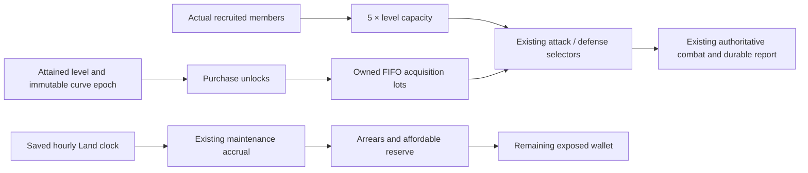

# Level-100 expansion — E1 master plan

**Research/architecture only.** Baseline: latest `release/production` at `7cf9a3a48284c96afe922b3473cce429339bd7e4`, including merged PR #31. Schema remains **022_player_foundations.sql**. No active runtime/catalog/schema/artwork/release file is changed; no production access, provisioning, deployment or protected workflow. The implementation-ready sequence below is a proposal for subsequent owner-approved work, not an installed expansion.

## Recommended decisions

1. Adopt **maximum participating army = max(5 × level, existing legacy floor)** in a future version. Count the leader inside that number. Participation remains `min(capacity, 1 + actual retained militia + accepted allies)`, with per-category equipment limited to actual owned copies. No automatic recruitment, gold-militia endpoint, logarithmic power discount or new currency.
2. Keep levels 1–50 XP requirements and the approved 65% bot XP/repeat/gold formulas. For future post-50 transitions, study `legacyRequirement(L) + 150 × max(0,L−50)`. This gives 11,750 XP for level 100→101 and 382,625 cumulative XP to reach 100 for a fresh account. Version the curve and grandfather existing attained levels/XP/current-level entitlements; never recompute levels from lifetime XP.
3. Move **future purchase unlocks**, not owned usability, for seven classic Astral/Ash/Eclipse items toward 80/90/100. Preserve every original ID/stat/price/artwork/receipt. Introduce seven grounded numerical-equivalent mid-level items and server-resolved alternative quest requirements. This avoids blocking old quests or forcing existing owners to rebuy. Add 36 authored upper-tier equipment definitions, 18 quests, six regions and six properties. All are uninstalled proposals.
4. Plan **900 total NPCs**, preserving all 450 old identities/records. Compare exact nine-per-level coverage with the recommended addition: 400 upper-level bots (eight per level 51–100) plus 50 stronger mid-level rivals. New bots have real saved armies, legal equipment and independently declared finite starting capital; their income then comes only from ordinary Land settlement.
5. **Do not approve the prototype NPC capitalization automatically.** The tested new cohort needs 1,522,562,892 held gold/reserves plus 8,658,396,919 of authored initial property/equipment investment. This is a visible fiscal decision, not permission to grant it. Review/approve or revise that budget and storage plan before any population implementation/activation.

The objective remains: levels unlock gear; recruited armies use owned copies; Land funds all upkeep; competition/reputation motivate play. Balanced gear may be substantially more expensive than offense, tank or economy builds. No crafting, enhancements, prestige resets, extra currency, clans or new combat rewards are implemented.

## Evidence and limits

Owner-confirmed original-game evidence is treated as historical authority: the Recruit screen's 5× rule, 630/685/735/755 participating armies, hundreds of selected equipment copies, offensive/defensive ownership, diverse builds and large upkeep-funded estates. The E1 workspace does not contain a newly attached original screenshot package; this report does not claim a fresh pixel inspection or recovered Storm8 server code. Exact old bounty-limit numbers remain unverified. Do not substitute current reconstructed numbers as historical facts.

The current implementation is directly inspected and hashed in [machine inputs and source hashes](docs/level100-e1/provenance.json). Results are deterministic synthetic projections, not production telemetry. Existing NPC blueprints are starting references; live autonomous bots may already have different levels, equipment, estates and purses. No live state was queried.

## Study map

- [ARMY_SCALING_STUDY.md](ARMY_SCALING_STUDY.md): capacity versus recruitment, equipment demand, integer limits and efficient selection.
- [PROGRESSION_100_SIMULATION.md](PROGRESSION_100_SIMULATION.md): 72 finite-resource cases, seeds, schedules, loss/recovery accounting, ablations and pacing limitations.
- [EQUIPMENT_ECONOMY_100.md](EQUIPMENT_ECONOMY_100.md): four builds, progressive Land investment and the single 5.1D upkeep clock.
- [CONTENT_51_100.md](CONTENT_51_100.md): complete proposed definitions, legacy mirrors and future artwork briefs.
- [BOT_POPULATION_100.md](BOT_POPULATION_100.md): identity preservation, capitalization, scheduling, storage and 900-bot gates.
- [PRESERVATION_AND_MIGRATION_PLAN.md](PRESERVATION_AND_MIGRATION_PLAN.md): precise compatibility and protected-release sequence.
- [COMBAT_BOUNTY_DECISIONS.md](COMBAT_BOUNTY_DECISIONS.md): retained Phase 5.1D research; none of its proposals is activated.

## Architecture: extend the existing systems



Reuse `activeArmy`, quantity-based selection, `readInventory`, FIFO lots, `buyEstate`, shared `income_cycles`, maintenance accounts/journals, command receipts, actual-wallet loot, persisted rivalry aggregates and typed release proofs. Do not introduce another scheduler, combat resolver, payment clock, client-side economy or framework.

## Dependency-ordered implementation slices

| Slice | Concrete work | Gate / risk |
|---|---|---|
| E2a: compatible engine | New immutable catalog/curve interfaces; purchase-versus-owned-use separation; aliases for seven moved requirements; larger safe participant/stack validation; bounded FIFO resale prefix; SQL army counts separate from paged roster | Keep current active policy/content and 450 bots until compatibility code is deployed; no data resets |
| E2b: human expansion | Register approved definitions; enable 5× capacity and authored content; use immutable per-character progression epochs and the approved post-50 curve | Dedicated migration/rolling-cutover tests; every existing owned item remains usable; exact future schema pin, no dynamic acceptance |
| E3a: NPC preparation | Add cohort metadata/initial contingent records; typed append-only manifest for new identities/capital; 900-copy query and storage tests | No existing-bot reprovision/upgrade loop; owner must approve the finite fiscal budget |
| E3b: controlled population | Separately reviewed manifest-bound population protocol, independent restored-copy rehearsal and exact identity/capital diffs | Existing normal migration checker remains strict; current 450 count guards cannot simply be bypassed |
| E3c: autonomy activation | Reviewed 900-population scheduler policy, bounded candidate budget, unchanged normal combat and source-funded buying | Preserve old receipts/cutover idempotency; new-cohort activation is explicit; no bot-human attacks |
| E4: alpha tuning | Observed acquisition/upkeep/XP distributions, match availability, recovery duration and database bytes/day | Only separately reviewed numerical changes; do not tune by modifying live wallets |
| Later competition | Basic clans, optional defender gold and bounty placement revisions | Separate owner decisions after expansion; no new mechanics here |

E2a/E2b are deliberately separate if XP/unlock activation could race an older process. Install a compatibility reader first; only an owner-approved subsequent cutover activates the new immutable policy. An append-only activation ruleset can use the existing immutable rules registry, rather than changing business rows or adding public control endpoints. All processes that might still serve requests must understand the new IDs/epoch before activation. If the deployment platform cannot establish that, use an explicitly authorized short write-drain/maintenance cutover; do not accept a mixed-formula race or alter the release workflow ad hoc.

## Competitive compatibility

Current human defenders already earn XP, including the separate three-full-victories-per-pair budget; defense does not refill resources on level-up. Ordinary losses and bounty-finishing Kills/Deaths remain separate. A defensive winner can still lose Health to zero: winning power is not an immortality guarantee. Do not automatically pay a bounty merely because that happens; the current claim requires a qualifying finishing attacker.

Retain the prior conservative defender-gold research as **unapproved**. Level-independent bounty sponsorship must remain separate from attack/claim level eligibility, escrow/refund and ally/sponsor exclusion. Historical repeated targeting/clan rivalries justify memorable durable identities and history, not guessed historic caps, automatic cross-level attacks or new payout multipliers.

Current bounty rules remain reconstructed Kingdom Come policy: 1–10,000 principal, 10% fee (minimum 1), one active contract per target and 50 target placements per rolling day, with the current onboarding/relative-level, sponsor/ally and finishing-proof checks. Re-listing after a contract ends is possible subject to those counters; expiration/cancellation returns principal once, never the burned fee. These are **not** asserted as recovered historical Storm8 numbers. Keep them unchanged for the expansion. Any later sponsor-pair/target limits should be separately simulated from actual escrow transfers and abuse cases, not guessed from screenshots. Clan affiliation alone must not bypass or silently alter existing claim eligibility.

The prior report's proposal to separate cross-level *placement* from qualified *claiming* remains unapproved. A low-level sponsor funding a high-level target must never grant the sponsor or another ineligible character permission to attack. An ordinary defeat, a successful defense and a bounty-finishing death must remain independently represented in persisted records and visible statistics. Review repeated claims, allied/alternate-account funding and concurrent refund/claim races before any new policy.

Existing rivalry records are already UUID-based. Later basic Clans can add `clans` plus audited membership intervals/consent without rewriting army membership or past battles. Record clan membership snapshots on *new* relevant events if historical affiliation is needed; never infer it by current name/tag. No automatic army, stat, income, notification or bounty entitlement should follow merely from clan membership. Reuse existing moderation and personal-feed visibility. No clan tables or UI are created in E1.

## Genuine owner decisions before implementation

- Approve 5× capacity and the legacy-floor exception; accept that a 21-day level-100 player may not yet recruit all 500 slots.
- Approve the +150 post-50 curve/epoch cutover, or choose the documented tradeoff. Frequent short visits remain faster than one long session; no arbitrary daily XP cap is proposed.
- Approve seven purchase retierings and seven exact mid-level mirrors with alternative old-quest requirements. The lower-complexity alternative is to keep old unlocks and add only new prestige items, but it weakens the requested visual hierarchy and requires rechecking new intermediate gear value.
- Approve/revise NPC starting capital, income and paid-lot footprint. The current prototype is fully accounted but too large to treat as a routine operational detail.
- Approve a future exact-manifest provisioning/release extension. A schema-only additive upgrade cannot legitimately add 450 accounts under today's strict unchanged-business-row/450-bot checks.

## Reproduce and verify

From `knights-reforged` on this draft's commit:

```sh
npm ci --no-audit --no-fund
npx tsx scripts/level100-e1.ts --check
npx tsx --test tests/level100-e1.test.ts
npm run typecheck
```

Omit `--check` to regenerate the committed JSON/CSV from fixed inputs. No database, Railway, network, seed or provisioning operation is used by either research script. Existing full CI still runs its ordinary disposable fixtures. One final complete exact-head CI is recorded in the draft PR, including all release/backup/restore regressions. This E1 PR must remain draft for owner review; no merge or deployment.
