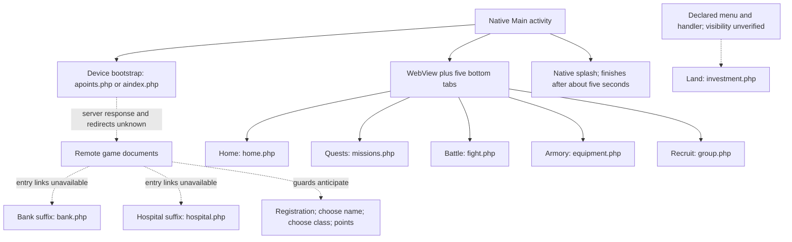

# Kingdoms Live 1.6.3: original game evidence and recreation specification

Analysis date: 2026-10-17. Target: the user-supplied Android APK, examined offline. This report does not change the existing prototype, define recovered server formulas, or certify gameplay parity.

## Findings that affect the recreation

1. **This APK is principally a WebView client.** One native `WebView` displays remote PHP pages, with five native bottom tabs and native backgrounds, sounds, dialogs, billing, and push notification support. There is no bundled game HTML, JavaScript application, mission catalogue, equipment catalogue, Land catalogue, or native combat/economy implementation identifiable in the supplied files.
2. **The five bottom labels and their order are verified:** Home, Quests, Battle, Armory, Recruit. Their routes are `/home.php`, `/missions.php`, `/fight.php`, `/equipment.php`, and `/group.php`.
3. **Land is independently evidenced by a menu declaration and a route handler for `/investment.php`.** The menu resource also names Home, Quests, Battle, Armory, and Recruit. However, the base activity's `onCreateOptionsMenu()` returns `false`, and no menu inflation call was found. The declaration does **not** prove that this native menu was visible in this build. Server-provided links to Land cannot be reconstructed from this APK.
4. **Bank and Hospital are identifiable page families with dedicated artwork.** Their page suffixes are checked by the WebView background selector. Their forms, fees, balances, healing behavior, and entry links are absent.
5. **The Land income interval of 60 minutes comes from the user's recollection.** It is a recreation requirement with a recorded source, not an APK-verified timer. Original Land yields, prices, upkeep rules, payout alignment, and offline accrual policy remain unknown.
6. **The prototype's paid Militia recruitment, single Iron sword, Border patrol, regeneration, level progression, and PvP arithmetic are provisional recreation features.** This APK does not establish their original counterparts or values. In particular, `Recruit` → `group.php` does not prove an original unit shop.

The existing server-rendered multiplayer architecture is a useful foundation. Faithful screen structure and recovered artwork can be restored before changing balance rules. Economic and social mechanics need additional evidence or an explicitly separate recreation ruleset.

## Evidence levels

| Label | Meaning |
| --- | --- |
| **V — verified in APK** | A resource, literal, method, or instruction sequence directly demonstrates the stated fact. A page name alone verifies a page reference, not the page's complete behavior. |
| **I — inferred** | A plausible interpretation of verified evidence. The APK does not establish the full behavior. |
| **R — player recollection** | Supplied by the user; retained separately from APK evidence. |
| **U — unknown** | Not recoverable from the examined APK. Do not replace this with an invented original value. |
| **P — prototype source** | Observed in the current project. Describes recreation code, not the historical game or a new runtime test. |
| **D — proposed design** | Recommended future implementation work. It has not been implemented by this analysis. |

Confidence is attached to individual claims. For example, “Hospital page reference exists” is V; “healing is bought with banked gold” is U.

## Scope, provenance, and reproducibility

The attachment was copied byte for byte into [original-reference/KingdomsLive-1.6.3.apk](original-reference/KingdomsLive-1.6.3.apk), then extracted into [original-reference/extracted/](original-reference/extracted/).

| Property | Verified value |
| --- | --- |
| APK size | 1,183,103 bytes |
| APK SHA-256 | `671e7650511e2c2dbfbd010dd85813e9ec6bf1d77c7c4ca8f459b6d141a1b5e0` |
| Manifest package | `com.storm8.kingdoms12` |
| Manifest version | `versionName="1.6.3"`, `versionCode="21"` |
| Client protocol version | `Main.getClientVersion()` returns `a1.63` |
| Minimum / target SDK | Both 5 |
| Orientation | Main and Splash declare portrait |
| ZIP entries | 60; ZIP CRC check passed |
| DEX | One `classes.dex`, 540,152 bytes, DEX 035 |
| DEX coverage | 273 defined classes, 2,359 method references, 3,444 strings |
| Disassembly coverage | All 1,515 methods with code; 27,186 instruction/payload records |
| Android resources | All 13 binary XML files decoded, including manifest; `resources.arsc` decoded |
| Packaged content | 30 raster images, 7 drawable XML files, 4 layout XML files, 1 menu XML file, 11 audio files |
| Not present | `assets/`, native `lib/` binaries, bundled HTML/CSS/JavaScript/PHP pages, local game database |

JADX and apktool were unavailable. An existing offline Python DEX reader and binary Android resource reader were adapted into self-contained reference tools. These parse DEX tables and instructions, resource IDs, binary XML, and the resource table without executing APK code. The output is Dalvik disassembly, **not recovered original Java source**. Human-readable behavioral summaries below follow the actual call sites.

DEX SHA-1 and Adler-32 both match their stored header values. Instruction widths and direct branch/payload destinations passed the structural audit; this is not an Android runtime verifier. No APK or emulator was launched, no remote resource was fetched, and no legacy host was contacted. Manifest/package strings identify the supplied artifact; publisher identity and signing-certificate provenance have not been independently authenticated.

Evidence entry points:

| ID | Local evidence | What it establishes |
| --- | --- | --- |
| E01 | [Decoded manifest](original-reference/analysis/decoded/AndroidManifest.xml) | Version, package, activities, permissions, market flags |
| E02 | [Main class disassembly](original-reference/analysis/disassembly/com/storm8/kingdoms12/Main.dex.txt) | Tab definitions, direct routes, menu handler, host, background resource IDs |
| E03 | [Base activity disassembly](original-reference/analysis/disassembly/com/storm8/base/Storm8MainActivity.dex.txt) | WebView setup, startup, device identity, page loading, tab state, Back behavior, bridge, dialogs |
| E04 | [WebView client disassembly](original-reference/analysis/disassembly/com/storm8/base/Storm8WebViewClient.dex.txt) | URL interception, cookies, request hash helpers, time synchronization, loading/errors |
| E05 | [Background selection callback](original-reference/analysis/disassembly/com/storm8/base/Storm8WebViewClient$2.dex.txt) | Page suffix → native background mapping |
| E06 | [Decoded main layout](original-reference/analysis/decoded/res/layout/main.xml), [tab layout](original-reference/analysis/decoded/res/layout/tab_button.xml), [menu](original-reference/analysis/decoded/res/menu/menu.xml) | Native screen composition, dimensions, labels, declared menu entries |
| E07 | [Resource table](original-reference/analysis/resource-table.json), [resource ID map](original-reference/analysis/resource-id-map.json) | Resource names, values, file variants |
| E08 | [APK file inventory](original-reference/analysis/apk-inventory.json), [image inventory](original-reference/analysis/image-inventory.json), [local asset gallery](original-reference/analysis/asset-gallery.html) | Every supplied file/asset, hashes, dimensions, visual inspection |
| E09 | [DEX index](original-reference/analysis/dex-index.json), [class inventory](original-reference/analysis/class-inventory.json), [string cross-references](original-reference/analysis/string-xrefs.json) | Searchable class/method inventory and literal use sites |
| E10 | [Offline audit](original-reference/analysis/offline-audit.json), [DEX integrity](original-reference/analysis/dex-integrity.json) | Structural coverage and integrity checks |
| E11 | [Prototype baseline](original-reference/analysis/prototype-baseline.json), [preservation verification](original-reference/analysis/verification.json) | Existing files preserved during this analysis |

Reproduction instructions and limits are in [original-reference/README.md](original-reference/README.md).

## Compiled code: game shell versus supporting libraries

The game-specific package contains only 15 class definitions:

| Classes | Role | Evidence |
| --- | --- | --- |
| `com.storm8.kingdoms12.Main` | Concrete game configuration: hosts, client version, five tabs, menu routing, sound/resource lookup, backgrounds | V, E02 |
| `com.storm8.kingdoms12.Splash` | Supplies the native splash layout to `Storm8Splash` | V, class disassembly |
| `com.storm8.kingdoms12.C2DMReceiver` | Configures notification title/icon/layout and push sender | V, class disassembly |
| `BuildConfig`, `Manifest`, `Manifest$permission` | Generated build/permission constants | V, E09 |
| `R`, `R$attr`, `R$drawable`, `R$id`, `R$layout`, `R$menu`, `R$raw`, `R$string`, `R$style` | Generated resource IDs; no game simulation | V, E07/E09 |

The shared Storm8 package contributes 48 definitions:

- `Storm8MainActivity`, its `$1`–`$13` callbacks, and `$TabButtonInfo`: lifecycle, WebView/native bridge, tabs, dialogs, purchase callbacks.
- `Storm8WebViewClient` and `$1`, `$1$1`, `$2`, `$3`: URL loading, page backgrounds, loading indicator, cookie/hash helpers.
- `Storm8WebChromeClient` and `$1`, `$2`: JavaScript confirmation dialogs and their OK/Cancel callbacks.
- `Storm8Splash`, `$1`, `$1$1`: splash activity and a five-second delay.
- `AmazonStoreManager` and `$AmazonPurchasingObserver`: optional market integration.
- 20 `com.storm8.base.util.iap` definitions: purchase objects, inventory, verification, billing helper, callbacks, and Base64 support. This billing `Inventory` is not a player equipment inventory.

Other definitions are 129 Gson, 30 Apache Commons Codec, 10 named Google Ads, 4 C2DM support, 3 Google billing interfaces, 2 Android annotations, and 32 root-level obfuscated classes. The root classes reference the Google Ads types, advertising messages, `AFMA_ReceiveMessage`, AdMob URI handling, and `Ads` logging; they are identifiable as advertising support rather than evidence of a hidden game simulation. Calendar fields such as `hourOfDay` and `minute` occur in a Gson Calendar serializer, not a Land payout routine.

There are no identifiable character/mission/Land/equipment/combat domain classes. This supports a thin-client interpretation, but does not reveal how the historical server was implemented or what JavaScript its pages contained.

## Original screens and navigation

### Native composition and startup

`res/layout/main.xml` is a vertical `LinearLayout`: a `WebView` above a 50 dp bottom tab bar. The WebView has no visible scrollbars in XML. Runtime code enables JavaScript, installs the Storm8 WebView and Chrome clients, exposes the main activity under JavaScript name **`android`**, clears the cache, and normally makes the WebView background transparent before assigning page backgrounds. A specific pre-2.2 Droid path uses a black background and skips the usual background callback.

The tab layout uses an image above a white 9 dp text label. The source layout is 49 × 46 dp, but `initTabBar()` calculates each tab's actual width as screen width / number of tabs, with height derived from the bar. The five tabs therefore share the available width. The placeholder `Equipment` text in `tab_button.xml` is replaced at runtime; it is **not** the live Armory caption.

`Main.onCreate()` initializes the WebView/tabs and starts the bootstrap request, then launches the separate Splash activity. Splash shows `default_bg.png` for approximately five seconds and finishes; server loading can therefore begin behind it. Successful login/registration redirects and their exact order are unknown.

### Primary navigation: exact order and labels

| Position | Exact bottom label | Direct route literal | Drawable selector | Native background | Certainty |
| --- | --- | --- | --- | --- | --- |
| 1 | Home | `/home.php` | `tab_button_home` | `bg_default.jpg` through fallback | V |
| 2 | Quests | `/missions.php` | `tab_button_missions` | `bg_missions.jpg` | V |
| 3 | Battle | `/fight.php` | `tab_button_attack` | `bg_attack.jpg` | V |
| 4 | Armory | `/equipment.php` | `tab_button_equipment` | `bg_equipment.jpg` | V |
| 5 | Recruit | `/group.php` | `tab_button_recruit` | `bg_default.jpg` via `getRecruitBg()` | V |

Click flow: a tab stores its page route in `View.tag` → click listener calls `tabButtonPressed(view)` → `loadPage(route)` → WebView client's `shouldOverrideUrlLoading()` → `WebView.loadUrl(fullURL)`. This is remote document navigation, not a native fragment or Activity per gameplay screen.

`switchTab(url)` checks whether the URL contains each tab's route and updates the selected state of its image and background. Land, Bank, and Hospital have no native bottom tab of their own; their suffixes do not match these five tab routes.

### Additional identifiable screens and surfaces

| Screen / surface | Directly evidenced element | What can be reconstructed | Missing evidence |
| --- | --- | --- | --- |
| Splash | Native Splash activity/layout and `default_bg.png` | Portrait branded splash; five-second delay | Whether timing varied in other releases |
| Bootstrap / entry | `/apoints.php?fpts=…` or `/aindex.php?…` | Device bootstrap request structure | Returned page/redirect chain; starting character state |
| Home | Native Home tab → `/home.php` | Label, route, icon, default background | Header statistics, profile/news links, action panels and ordering |
| Quests | Native Quests tab → `/missions.php` | Label, route, icon, background | Mission names, areas, prerequisites, rewards, costs, mastery, result screen markup |
| Battle / PvP | Native Battle tab → `/fight.php` | Label, route, icon, background | Opponent filtering, attack forms, stamina, eligibility, result/history layouts, formulas |
| Armory | Native Armory tab → `/equipment.php` | Label, route, icon, background | Categories, entries, quantities, prices, purchase/sale forms, equipment selection |
| Recruit / group | Native Recruit tab → `/group.php` | Exact Recruit label, route, icon, default background | Army member model, invite codes, roster, limits, requests, mercenaries or unit purchasing |
| Land | Menu title `Land`; handler → `/investment.php`; `buildings.png` | Declared route and Land menu icon | Working native menu visibility, server link location, Land list, purchase/sale forms, income values |
| Bank | Suffix `bank.php` → `getBankBg()` | Page recognition and dedicated background | Entry link, deposit/withdraw forms, fees, balance protection, limits, interest |
| Hospital | Suffix `hospital.php` → `getHospitalBg()` | Page recognition and dedicated background | Entry link, healing controls/cost, bank dependency, attack protection |
| Registration | `register.php` in tab-hiding logic | Client anticipates a registration page with hidden tabs | Fields, account linking/recovery, validation, exact sequence |
| Name choice | `choose_name.php` in tab-hiding logic | Client anticipates a naming page with hidden tabs | Rules, initial/rename distinction, fees |
| Class choice | `choose_class.php` in tab-hiding logic | Client anticipates a class selection page with hidden tabs | Class/race names, bonuses, selection changes |
| Points / premium page family | `points.php` in tab-hiding logic, bootstrap `apoints.php`, billing callbacks | Premium flow support and hidden tabs on matching URLs | Exact pages/titles, gem offers, shop prices and benefits |
| JavaScript confirm | `Storm8WebChromeClient.onJsConfirm()` | Native dialog titled Kingdoms Live; message supplied by page; OK / Cancel return JS result | Which game actions invoke confirmations and their original messages |
| Loading | WebView progress timer; `Loading...`; purchase `Processing...` | Delayed loading dialog, immediate transaction progress treatment | Server latency and page-specific loading states |
| Missing device ID | `Failure To Connect` / `Device is missing Android ID.` / Quit | Native error wording | Server-side identity failures |
| Connection failure | `Network Problem` / `Please check your internet connection.` / Retry / Quit | Native error and retry action | HTTP error body and server error codes |
| Purchase dialogs | `Thanks for your purchase`, failure dialog, static success string mentioning 60 gems | Literal dialog text exists in shared base code | Whether success dialog was used for every SKU; no verified offer catalogue |
| Quit confirmation | `Are you sure you want to quit?`, Yes / No in a dialog-building branch | A defined native dialog | Actual activation during normal Back navigation is not established |
| Push notification / toast | Native notification layout, C2DM handler for `alert` and `Type` fields | App icon/title and server-supplied message presentation; tapping status notification opens Main | Notification triggers, wording, timing, payload examples |

The `bank.php`, `hospital.php`, `register.php`, `choose_name.php`, `choose_class.php`, and `points.php` entries above are **suffix references**, not complete hardcoded navigation URLs. Paths such as `/bank.php` are consistent with the rest of the client, but the exact link targets and query strings are unavailable. Likewise, a tab-hiding guard is evidence that the client anticipated a page family, not a captured original screen.

No further original screens can be identified confidently from this APK. Player profiles, news feeds, leaderboards, comments, clans, bounties, skill allocation, transfer/account recovery, help, and settings should remain evidence requests rather than claimed recovered screens.

### Land menu caveat and Back behavior

The menu XML declares six entries in this order: **Home, Quests, Battle, Armory, Land, Recruit**. `Main.onOptionsItemSelected()` contains six matching route branches. Its packed-switch keys match the resource IDs. Nevertheless, `Storm8MainActivity.onCreateOptionsMenu()` returns `false`, `Main` does not override it, and no game menu inflater use was found. `getMenuId()` exists but has no identified call site. Therefore the menu is a surviving declaration/handler, with no verified visible activation path.

Hardware Back is explicit: when the current URL path is `/home.php`, finish the activity; otherwise load `/home.php`. It does not call `WebView.goBack()`. A malformed URL is caught. The separately defined quit-confirmation dialog must not be substituted for this verified Back path.

`refreshTabBar(url)` hides the tabs on URLs containing `register.php`, `choose_name.php`, `choose_class.php`, `points.php`, or `hideTabBar=true`; otherwise it shows the tabs and updates selection. Because this is substring matching, `apoints.php` also matches `points.php`.

Solid arrows describe direct native code paths. Dotted arrows mark unavailable server navigation or an unverified entry point.

## Assets and their original placement

All paths in this section are relative to `original-reference/extracted/`. Image dimensions are native pixel dimensions, not responsive layout requirements. Visual descriptions come from inspecting the supplied images. The original resources have been kept separate from `public/art/` so the application has not changed.

### Backgrounds and branding

| Original file | Dimensions | Visual content | Original placement and confidence |
| --- | --- | --- | --- |
| `res/drawable/default_bg.png` | 320 × 480 | Kingdoms Live logo, blue-eyed armored warrior, burning town | Native splash `res/layout/splash.xml`, V |
| `res/drawable/bg_default.jpg` | 320 × 480 | Dark stone castle/tower | WebView fallback background, including Home and Recruit; Land falls through the same default selector if opened, V |
| `res/drawable/bg_missions.jpg` | 320 × 480 | Dark fortified bridge over water | Quests / `missions.php`, V |
| `res/drawable/bg_attack.jpg` | 320 × 480 | Fire, castle, skulls and horned staff | Battle / `fight.php`, V |
| `res/drawable/bg_equipment.jpg` | 320 × 480 | Sword and shield over a dark red radial field | Armory / `equipment.php`, V |
| `res/drawable/bg_bank.jpg` | 320 × 480 | Stone-vault passage with barred opening | `bank.php`, V |
| `res/drawable/bg_hospital.jpg` | 320 × 480 | Dim interior with wooden furnishing, books and candles | `hospital.php`, V |
| `res/drawable/icon.png` | 160 × 160 | App emblem | Manifest, toast and notification resource references; Android chooses density variant where applicable, V |
| `res/drawable-ldpi/icon.png` | 36 × 36 | App icon variant | Density-qualified `icon` resource, V |
| `res/drawable-mdpi/icon.png` | 48 × 48 | App icon variant | Density-qualified `icon` resource, V |
| `res/drawable-tvdpi/icon.png` | 64 × 64 | App icon variant | Density-qualified `icon` resource, V |
| `res/drawable-hdpi/icon.png` | 72 × 72 | App icon variant | Density-qualified `icon` resource, V |
| `res/drawable-xhdpi/icon.png` | 96 × 96 | App icon variant | Density-qualified `icon` resource, V |
| `res/drawable-xxhdpi/icon.png` | 144 × 144 | App icon variant | Density-qualified `icon` resource, V |

These are decorative backdrops, not screenshots of complete screens. They contain no mission/item/Land price table. The code applies them to the WebView; the appearance and positioning of remote document content over them cannot be recovered.

### Navigation art: every packaged icon

Every icon in the following table is 30 × 30 pixels under `res/drawable/`.

| Files | Placement established by code/resources |
| --- | --- |
| `home.png`, `home_selected.png` | Home tab normal/selected selector; `home.png` also declared Home menu icon |
| `missions.png`, `missions_selected.png` | Quests tab normal/selected selector; `missions.png` also declared Quests menu icon |
| `attack.png`, `attack_selected.png` | Battle tab normal/selected selector; `attack.png` also declared Battle menu icon |
| `equipment.png`, `equipment_selected.png` | Armory tab normal/selected selector; `equipment.png` also declared Armory menu icon |
| `recruit.png`, `recruit_selected.png` | Recruit tab normal/selected selector; `recruit.png` also declared Recruit menu icon |
| `buildings.png` | Declared Land menu icon; no corresponding native bottom tab or selected-state asset |
| `home_w.png` | Default image in the tab layout, replaced by the Home selector during tab construction |
| `missions_w.png`, `attack_w.png`, `equipment_w.png`, `recruit_w.png` | Packaged alternate icon resources; no active game-shell use identified beyond generated resource constants |

The five `tab_button_{home,missions,attack,equipment,recruit}.xml` selectors choose `{name}_selected.png` for selected state and `{name}.png` otherwise. The unused alternate `_w` variants should not be assumed to be the live normal icons.

`tab_bg.xml` defines a black-to-dark-gray vertical gradient for the bar. `tab_button_bg.xml` defines rounded 5 dp corners, a gray selected gradient, green pressed gradient, and transparent idle fill. These are seven drawable XML resources in total, including the five icon selectors.

### Layouts, text, and audio

The four native layouts are `main.xml`, `tab_button.xml`, `splash.xml`, and `notification_toast.xml`. The toast has a 48 dp icon and white text on a translucent gray panel; its placeholder notification text is replaced by a push message. The resource table contains just two string resources: `app_name = Kingdoms Live` and a scaffold `hello = Hello World, Home!`. That scaffold is not evidence of a user-visible original game screen.

All eleven audio files are under `res/raw/`:

| Files | Verified capability / unknown placement |
| --- | --- |
| `tap.3gp` | `invokeTapSound=true` causes lookup of raw resource `tap`; exact original actions requesting it are unavailable |
| `angel1.3gp`, `fireball.3gp`, `fireball2.3gp`, `fireball3.3gp`, `powerup1.3gp`, `powerup2.3gp`, `soldiers1.3gp`, `sword1.3gp`, `wood1.3gp`, `music1.3gp` | Packaged raw resources retrievable by name through `getSoundResource()` and the `invokeSoundCAF` parameter; precise game events, semantics, and music-loop behavior are unknown |

Names such as `fireball`, `soldiers`, and `angel` do not verify a spell system, troop catalogue, race list, or item. Browser playback support for these legacy audio containers has not been tested. Future format conversion should preserve originals and record any conversion separately.

There are no separate item thumbnails, mission illustrations, Land/building catalogue images, currency/stat icons, fonts, or HTML interface sprites identifiable among the supplied files. Those might have been remotely delivered; their original content and URLs cannot be reconstructed here. `buildings.png` is a single navigation icon, not a Land catalogue.

## Client–server architecture and observable protocol

### Host and responsibility boundary

`Main.getHostPrefix()` returns **`kl.storm8.com`** when `isQA()` is false; `isQA()` returns false in this build. A QA branch names **`qa.kl.storm8.com`**. `loadPage()` constructs `http://` + host + route. These are recorded as inert historical identifiers, not links or targets to request. The Bluepaw `/kr/` server from the separate Knights Reforged package is not this APK's game host.

| Responsibility | Evidence and conclusion |
| --- | --- |
| Native Android client | V: WebView lifecycle, tabs, route selection, local backgrounds/audio, JS confirmation dialogs, device metadata, cookie access, loading/error dialogs, purchase integration, push display |
| Remote page delivery | V: PHP routes loaded as WebView documents, JavaScript enabled, JS bridge installed; no local game document bundle |
| HTML rendered by the WebView | I, very strong: ordinary remote documents with forms, JavaScript callbacks, tab-hiding page names and native JS confirm handling. Actual response bytes/content types are unavailable |
| Server-generated HTML versus downloaded HTML + JavaScript | U at the rendering implementation level: PHP naming and page navigation strongly suggest server-rendered HTML, but the APK cannot distinguish PHP templates from HTML containing substantial remote JavaScript |
| Authoritative economy, character persistence, mission outcomes, PvP outcomes | I: must have been provided outside this native shell for multiplayer play; no corresponding native gameplay implementation or balance data was found. Exact division between remote JS and backend calculations is U |
| Original server language/database/deployment | U: `.php` paths are evidence of public route names, not recoverable server source, schema, infrastructure, or concurrency policies |
| Realtime transport | No Storm8 gameplay WebSocket/socket protocol was identified. Request/page-based play is strongly supported. This does not prove the downloaded pages never polled or made AJAX requests |

The useful reconstruction boundary is **replacement authoritative backend → replacement HTML/views → browser or modern Android WebView**, retaining native features only where they help. Reimplementing the old device authentication, billing services or broad JavaScript bridge is not necessary for gameplay parity.

### Bootstrap, identity, and sessions

Verified `checkPlayerlogin()` behavior:

1. Read `Settings.Secure.android_id`. Read `TelephonyManager.getDeviceId()` as an additional identifier; use it if Android ID is missing. With neither available in a production build, show the missing-ID dialog.
2. Calculate `pf` as an MD5-based device proof using the selected identifier, an embedded per-game constant, and the point-package value when nonzero. This is a client algorithm, not proof of how the server authenticates it. No real identifier or valid session was obtained or used.
3. Choose `/apoints.php?fpts=<pointPackageValue>&` when the point-package value is nonzero; otherwise choose `/aindex.php?`. **This manifest sets `point_package_value` to 12**, so the `apoints.php` bootstrap branch is selected from the supplied metadata. It does not establish a player currency starting balance.
4. Append the following URL-encoded metadata, clear the `st` cookie by assigning `st=`, and load the constructed URL.

| Parameter | Source observed in native code |
| --- | --- |
| `fpts` | Nonzero manifest point-package value, 12 in this package; semantic effect U |
| `version` | Client protocol version `a1.63` |
| `asid` | Selected Android/device identifier |
| `adid` | Telephony device ID or empty string |
| `udid` | Same selected identifier used for `asid` |
| `pf` | MD5-based device proof |
| `model` | `Build.MODEL`, fallback `Unknown` |
| `sn` | Literal `Android` |
| `sv` | `Build.VERSION.RELEASE`, fallback `Unknown` |
| `source` | Manifest market source `androidmarket` |

`CookieManager` handles cookies. `getSessionToken()` obtains the host cookie string, checks whether it starts with `st=`, strips that prefix, and URL-decodes the remaining text; otherwise it returns empty. This is a simplistic native extraction, not evidence of a complete multi-cookie parser. The server's `Set-Cookie` attributes, expiry, rotation, invalidation, identity transfer rules and account-password options remain U. The startup path is device-based; no username/password login form is bundled. The server-provided registration screen could still have supported account features not visible in native code.

`loadPage()` can append `dt=<URL-encoded C2DM device token>` to selected entry/primary routes once when `needToSendDeviceToken` is true and a token exists. Push registration is a native support feature; it does not reveal game notification rules.

### Page controls, forms, and request-signing helpers

Verified URL controls in `shouldOverrideUrlLoading()`:

| String / hook | Native behavior |
| --- | --- |
| URL starts with `market` | Open an Android ACTION_VIEW intent |
| `stopLoad=true` | Consume navigation without loading a document |
| `restartApp=true` | Call `checkPlayerlogin()` again |
| `serverTime` query field | Persist its integer value and the current client clock in preferences |
| `hideTabBar=true` | Hide bottom navigation through `refreshTabBar()` |
| `invokeSoundCAF=<raw-name>` | Resolve and play a bundled sound when no media player is already active |
| `invokeTapSound=true` | Resolve and play `tap` under the same single-player guard |
| `android.urlCallback(url)` | Exposed public method that schedules tab-state refresh; it does not itself load the URL |
| `android.interceptFormData(text)` | Store `currentFormData` and call the ordinary URL-loading handler with the current WebView URL |
| `android.invalidateWebview()` | Request redraw |
| Purchase bridge methods | Start/check billing flows and notify purchase handling; not ordinary Armory purchase commands |

The whole activity object is exposed as `android`; the table lists meaningful observed methods, not captured calls from original remote JavaScript. That JavaScript is missing.

The client also contains `getHashedUrl()`, `computeHash()`, `calculateNewApiHash()`, and `loadPageWithHash()` helpers. They demonstrate an intended PHP signing path:

- For a PHP URL without `hash=`, calculate a `ts` value from stored server/client clock information, preserve a fragment, and append URL-encoded `hash`.
- Hash inputs include the `st` token, PHP basename, query string, and normalized intercepted form fields. The algorithm uses string mixing and Base64-encoded HMAC-SHA256 operations.
- A runnable helper would GET the hashed URL or use `WebView.postUrl()` if intercepted form data exists. The byte conversion passes the literal charset label `BASE64` to Apache `EncodingUtils.getBytes`; that call is **not** a Base64 decoder. No live form encoding sample exists.

**Reachability limit:** no invocation of `loadPageWithHash()` was found in the defined methods. The actual `shouldOverrideUrlLoading()` calls ordinary `WebView.loadUrl(url)`. Therefore these residual helpers do not establish that every request was signed or that native POST handling was used in this build. WebView-rendered forms or remote JavaScript could have supplied other behavior; it cannot be verified. Do not treat `ts` as an hourly income timer or request-signing support as gameplay validation.

### Purchases, push, and response formats

`processTransaction()` constructs `/android_market.php?&id=…&data=…&signature=…`. Amazon support constructs `/amazon_market.php?amazonid=%s&token=%s&sku=%s`. These are purchase verification/crediting page requests, distinct from `/equipment.php` game item spending. Manifest metadata enables IAP, disables AdMob, and selects `androidmarket`; optional libraries and QA branches are not proof of active features in a session. A static shared dialog mentions “60 gems”, but it supplies neither original prices nor the complete offer catalogue.

C2DM notifications read `alert` text and a numeric `Type` bitmask. They can show a toast and, when the game is not active, a status-bar notification. Native code does not distinguish a Land payout, attack, invitation or other game event in these messages. There is no APK evidence for a Land-specific local alarm.

| Response / payload family | What is recoverable |
| --- | --- |
| Game pages | Document navigation and browser/form/JS support are verified. HTML delivery is strongly inferred; actual HTML/CSS/JS, MIME types, encodings, redirects, DOM structure and status codes are U |
| Game action results | No original mission/combat/purchase/deposit/heal response sample or schema recovered; could be documents, redirects, or remote JS requests |
| Session state | Native `st` cookie consumption verified; token content, issuer behavior, lifetime and attributes U |
| Push | Native Android extras `alert`, `Type` verified; no real historical payload sample |
| Billing SDK JSON | SKU/purchase JSON handling is SDK functionality; does not establish a JSON gameplay API |
| Gson library | Presence alone is not evidence of a game REST API, hourly economy schema or gameplay serialization |

## Gameplay systems: verified, inferred, and unknown

### Land, hourly income, and upkeep

| Claim | Status | Evidence / limitation |
| --- | --- | --- |
| A screen labeled Land was designed into the client | V | Menu XML title, `buildings.png`, `/investment.php` selection handler |
| Land's complete page and entry link | U | No server HTML; native menu is not inflated in the examined callback |
| Land generated recurring income every 60 minutes | **R** | Explicit user recollection; no native payout routine or income string confirms it |
| Land ownership is a persistent investment/economy system | I | `Land` title plus `investment.php`, strengthened by recollection; data model unavailable |
| Original Land types, names, images, prices, quantities, unlocks and yields | U | No catalogue or numeric definitions found |
| Purchase/sale pricing, scaling with owned quantity, refunds, prerequisites | U | No forms or calculations found; sale support itself unverified |
| Income settlement aligned globally or separately per player | U | No timer/ledger/server implementation |
| Upkeep existed, which units/items incurred it, and how it was charged | U | No `upkeep` gameplay literal, table or calculation found |
| Net income = gross Land income minus upkeep | I as a candidate economy model, **not an original verified formula** | Requires external evidence; do not adopt as historical fact |
| Offline payouts, catch-up limits, partial hours, changing holdings mid-cycle | U | No evidence |
| Insufficient-income behavior, debt, loss of units/items | U | No evidence |

For future recreation, preserve the 60-minute interval as `source: player_recollection`. Do not silently convert the current 30-second health/energy ticks into Land rules. Separate gross income, any later-evidenced upkeep, and settlement history in the design so unresolved policy can be changed without rewriting accounts or PvP. The exact anchoring and catch-up policy need a documented reconstruction decision if no further source is found.

### Bank

**V:** `bank.php` is a recognized page suffix and selects `bg_bank.jpg`. **I:** a fantasy economy bank likely stores currency and may offer transfers between carried and banked funds. **U:** deposit/withdraw support, exact terminology, any fee percentage, minimum/maximum transaction, interest, protection from PvP theft, and whether Hospital spending draws from the Bank. A familiar fee from another Storm8 title is not evidence for this APK.

### Hospital and health

**V:** `hospital.php` is recognized and selects `bg_hospital.jpg`. **I:** a recovery/healing service. **U:** healing price/formula, amount healed, payment source, health cap, passive regeneration rate, minimum health needed to attack, immunity thresholds, cooldowns, and death behavior. The native image and route do not establish any numeric health rule.

### Equipment / Armory

**V:** Armory is the visible tab label; route `/equipment.php`; equipment normal/selected icon and background are bundled. **I:** a player equipment management/purchase page. **U:** item names/stats/prices, weapon/armor/spell categories, unlock levels, quantity limits, sale values, per-item upkeep, inventory ownership model, auto-equipping versus manual slots, and whether an army uses multiple copies. The single sword in the prototype and the sword/shield background are not catalogue evidence.

### Quests / missions

**V:** Quests tab routes to `/missions.php` with its own icon/background. **I:** progression through missions with a remotely defined list and results. **U:** mission/region names, descriptions, energy costs, XP and currency rewards, drops, success chances, required items/army size, mastery/repetition rules and unlock thresholds. Sound resource names do not establish a quest reward or battle outcome.

### Recruit, army, and social grouping

**V:** the fifth tab reads **Recruit** and loads `/group.php`; its background is the default castle. **I:** recruiting/group membership is associated with this page. A social army of other players is a plausible interpretation of `group`, but not demonstrated by a bundled form or model. **U:** invitations, friend/army codes, roster acceptance/removal, level-based capacity, active-versus-total members, combat participation, purchased nonplayer units or mercenaries, and any upkeep. This evidence does not justify relabeling the prototype's paid Militia shop as a faithful original Recruit implementation.

### PvP / Battle

**V:** Battle tab loads `/fight.php` and the attack background. **I:** asynchronous attack selection and results delivered through pages; the thin native shell has no combat engine. **U:** attack resource (stamina versus energy), costs, opponent matchmaking/ranges, simultaneous action rules, attack/defense aggregation, equipment contribution, army participation, randomness, ties, damage, loot, casualties, XP, cooldowns, battle history, revenge, bank protection, Hospital eligibility and abuse limits.

The current prototype's server-side PvP is a useful implementation component. Its numeric values and tie behavior are explicitly recreation choices, not recovered Kingdoms Live rules.

### Character, classes, currencies, progression

**V:** registration, name-choice and class-choice URL guards; native device/session bootstrap; a shared purchase message referring to gems. **I:** persistent named characters, selectable archetypes and a premium-currency flow. **U:** class names/effects, races, initial currency/stat allocation, levels/XP curve, skill points, attack/defense/health/energy/stamina values, stat regeneration, class changes, and economy display labels. Do not infer a stat system solely from what the prototype currently displays.

## Differences from the existing multiplayer prototype

Comparison sources: [HTTP contract](src/http-contracts.ts), [application routes](src/app.ts), [account code](src/auth.ts), [state handling](src/game.ts), [commands](src/commands.ts), [rule functions](src/rules.ts), [ruleset JSON](rulesets/recreation-0.1/rules.json), [schema](migrations/001_initial.sql), templates and [art provenance](public/art/provenance.json). These observations are P unless explicitly paired with V/R above.

| Area | Original evidence | Current prototype source | Consequence / priority |
| --- | --- | --- | --- |
| Architecture | Native shell + remote PHP documents | Fastify + EJS responsive HTML, PostgreSQL, JSON command endpoints | Compatible replacement approach; original path names need not dictate backend language |
| Accounts | Device-based bootstrap and `st` cookie; setup pages anticipated | Username/password, Argon2id, hashed random session tokens, CSRF, persistent character | Preserve portable accounts/security; original transfer or linking flow remains unknown |
| Primary navigation | Home / Quests / Battle / Armory / **Recruit** | Home / Quests / Battle / Armory / **Army** | First four labels align; fifth is a known presentation difference |
| Land | Declared Land/investment screen; 60-minute income recalled | No Land route, holding, income schedule or settlement table | Highest-priority missing economic feature; prices/yields need provenance or provisional labels |
| Upkeep | No verified APK rule | No upkeep model or charge | Do not add an assumed original percentage or unit fee |
| Bank | Page/background recognized | One carried `wallets.balance`; no bank commands/ledger account | Add only after policy is evidenced or explicitly provisional |
| Hospital | Page/background recognized | Passive health recovery; no Hospital screen/heal command | Screen is missing; healing/payment rules unknown |
| Armory | Equipment page; contents unknown | One Iron sword, one ownership row, one manual weapon slot | Catalogue, quantities and combat selection model are unverified recreation simplifications |
| Quests | Mission page; contents unknown | One repeatable Border patrol | Preserve playable quest while adding evidence-based content structure later |
| Army / Recruit | Group/recruit page; mechanics unknown | Paid Militia stacks, maximum 20; no player membership/invitations | Army data model may need a separate social membership system rather than renaming unit stacks |
| Combat | Fight page; no recoverable arithmetic | Server-authoritative attacks, two random rolls, health damage, currency transfer and stored reports | Keep transaction/report foundations; isolate balance from any future original ruleset |
| Character stats | Choice-page guards only; values unknown | Health/energy, XP/level, attack/defense; no class, race, skill or stamina fields | Existing stats cannot be presented as exact original statistics |
| Artwork | Kingdoms Live splash, 6 backdrops, 16 navigation icons, 7 app-icon files | Knights Reforged 6.0.4-derived artwork and custom layout | Keep provenance separate; original asset map now makes a future presentation pass possible |
| Screen layout | Portrait WebView and native 50 dp bottom bar | Responsive browser interface with desktop sidebar and compact mobile navigation | Adapt original visual identity responsively; exact historical HTML spacing remains unavailable |
| Native extras | Sounds, C2DM, store flows | Browser prototype does not implement these native services | Lower priority than core play; new push/billing is separate work |
| Reliability foundations | Original behavior unknown | PostgreSQL transactions/locks, idempotent commands, economy entries, rule-tagged battles | Retain while extending; do not replace functioning infrastructure to mimic unknown internals |

The following numbers are recorded **only to identify current provisional behavior**, all from `recreation-0.1`, not the APK:

- Starting gold 60; health cap 100; energy cap 10; +1 energy and +2 health per 30 seconds; one level per 50 XP.
- Border patrol costs 1 energy and awards 25 gold / 10 XP. Militia costs 12 gold each and adds 3 attack / 2 defense, capped at 20. Iron sword costs 40 gold and adds 8 attack / 1 defense when manually equipped.
- Base attack/defense are 5/5; each level beyond the first adds 2/1; unit and weapon bonuses are added linearly.
- An attack costs 2 energy, has a 10-second cooldown, and adds independent integer rolls from 0 through 6 to attacker attack and defender defense. Ties favor the defender. Winner damage is 3; loser damage is `min(30, 12 + floor(abs(power difference)/2))`. Loot is capped at 10 and the loser's balance; attacker gains 5 XP; no unit casualties are applied.

None of these numbers should be copied into a table labeled “original Kingdoms Live.” The ruleset already says that original server formulas were not recovered.

### Testing and preservation boundary

This analysis did not install dependencies, change migrations, run gameplay commands, apply database migrations, or claim new TypeScript/runtime/browser verification. The repository's existing `VERIFICATION_STATUS.json` records earlier dependency-blocked runtime testing; this report does not change that historical status or recertify the user's working environment. The comparison above is based on source inspection.

All 63 pre-existing project source/configuration/test/documentation/art files recorded at the start of this analysis are checked against their SHA-256 baseline. APK extraction, decoded evidence, scripts, the asset gallery, reference README and this specification are additive. No existing application asset, gameplay source, test or schema has been overwritten. See E11 for the final preservation result.

## Prioritized implementation plan

Everything in this section is D. It is a plan for a future change, not a claim that the original server is recoverable. Existing accounts, character persistence, commands and multiplayer play must remain available.

### 1. Restore the verified presentation and navigation

**First proposed implementation milestone: original identity and screen shell, without balance changes.**

- Add a separate Kingdoms Live asset namespace with source hashes; keep the current Knights Reforged art available.
- Use the exact primary labels/order Home, Quests, Battle, Armory, Recruit. Introduce an explicit visible secondary navigation area for Land, Bank and Hospital in the responsive interface; this is a documented modern accessibility/navigation choice because original server links and native Land menu visibility are unknown.
- Apply the verified backgrounds to their screens, selected-state icons to tabs, and original splash/emblem in appropriate branding contexts. Adapt the 320 × 480 assets to mobile and desktop with readable content; do not stretch low-resolution navigation icons into invented item art.
- Keep current HTTP command behavior intact. A Recruit view may continue linking to the existing unit shop as a clearly labeled provisional feature until its social model is resolved.
- Show evidence status in project documentation. Missing screen content should remain an explicit placeholder or existing provisional content, not fabricated original lists or fees.

**Acceptance:** registration/login and existing quest/recruit/equip/PvP flows still work; no account data loss; five labels/order and route links are exercised in a browser; active navigation and backgrounds are checked at a phone viewport and desktop width; all art links resolve locally; no historical host is requested. Land/Bank/Hospital placeholders perform no invented financial actions.

### 2. Resolve the economic and army evidence gaps

Collect user-supplied screenshots, saved original HTML, recordings, old guides or additional recollections before filling original tables. Record source/date/version and confidence per entry. Do not query the historical service. Prioritize Land names/yields/prices and the meaning of Recruit/army, then Bank/Hospital, equipment contribution, mission data and PvP costs.

Questions to resolve from evidence include:

- Was income global-clock or per-player, paid while offline, and based on holdings at which point in the hour?
- What incurred upkeep, when was it charged, and what happened when income or carried funds were insufficient?
- Did Bank deposits incur fees, did balances resist theft, and did Hospital charges use banked funds?
- Did Recruit add player members, nonplayer units, or both; how were active members and equipment selected for battle?

These are a research backlog, not requests to halt the present analysis. If evidence cannot be found, document an explicit reconstruction decision for each behavior and version it separately from verified content.

### 3. Implement the Land income loop on the existing backend

This should be the first new gameplay milestone **after** the presentation pass and evidence decision. Use the recalled **60-minute** interval with its R provenance. Catalogue prices/yields and unresolved policies must stay absent until sourced, or be clearly marked provisional in a distinct playable ruleset.

- Add forward-only migrations for Land definitions/holdings and uniquely identified settlements. Reuse transaction locks, command receipts and economic ledger entries; preserve existing character balances and unit stacks.
- Settle due intervals on the server with a persisted cursor and uniqueness constraint. Both page reads and commands must observe the same settled state. Browser countdowns only display server timestamps.
- Record the ownership/definition version and settlement policy used for each credited interval. A restart, duplicate request, concurrent worker or two browser tabs must not issue the same payout twice.
- Keep payout anchoring, offline catch-up, purchase-boundary behavior, and any upkeep policy explicit and versioned. They are engineering/design choices until evidenced. Use integer currency and database transaction boundaries; select storage bounds for potentially long offline periods.
- Add Land UI and authenticated purchase commands only once catalogue policy is set. Any sale command needs separate evidence or a provisional decision; its existence is not verified by `investment.php`.

**Acceptance:** fixed-clock tests before/at/after a 60-minute boundary; partial intervals; long absence; restart recovery; concurrent settlement/purchase; retry deduplication; unauthorized/tampered purchases; and PostgreSQL integration tests. Every expected amount derives from a cited catalogue or an explicitly provisional fixture, never a claimed recovered formula.

### 4. Add Bank, Hospital, and any evidenced upkeep

Add carried/banked account distinctions and transfer/heal commands as forward-only changes, after documenting fees and payment-source policy. Settle due income consistently before spending. Reuse ledger auditing and lock ordering for bank, purchases and attacks. Add upkeep as its own recorded charge only when evidence or a reconstruction decision defines it; specify insolvency behavior before enabling deductions.

**Acceptance:** money conservation for transfers, no duplicate fees/credits, no negative balance or double spend, concurrent attacks/withdrawals/healing, correct health cap, and explicit separation of original evidence from provisional configuration.

### 5. Resolve Recruit and expand original content

If corroborating evidence establishes a social player army, add membership/invitation tables and commands alongside the existing NPC stacks. Do not silently reinterpret or delete existing militia. Introduce data-driven equipment quantities/categories and mission catalogues with provenance and versioned rules. Class/race/stamina/skills should be added only with evidence or clearly identified reconstruction choices.

**Acceptance:** membership authorization/deduplication, persistent roster, no regression to current unit recruitment; inventory ownership and quantity checks; mission prerequisites and rewards computed on the server. Capacity and equipment-selection rules require separate cited tests once known.

### 6. Rework PvP using sourced or explicitly reconstructed rules

Retain the server command boundary, stable two-character lock order, deterministic recorded inputs, battle snapshots and ledger transfers. Replace only the versioned rules that evidence actually establishes. Resolve attack resource, health thresholds, army contribution, equipment use, damage, loot and bank interaction explicitly before presenting results as faithful.

**Acceptance:** two independent accounts/devices can attack and view authorized reports; concurrent and replayed commands cannot duplicate rewards or overspend; offline defenders persist; each battle records the exact ruleset used; no claim of original arithmetic without provenance.

### 7. Android/PC delivery and optional native features

Keep one authoritative service and responsive browser client for PC/Android; a later modern Android wrapper can add installation, audio and notifications. Use the replacement service and portable account sessions. Avoid relying on obsolete phone identifiers, C2DM, legacy billing components, or an unrestricted activity bridge. Audio format conversion, notification behavior and any future paid currency should be independent, tested features. This analysis neither deploys the game nor introduces billing.

## Evidence still needed for faithful balance

The blockers to exact original parity are missing historical server pages/data and unsupported mechanics, not a need to search for more APK-side formulas indefinitely. Highest-value artifacts would be original Land/income/upkeep screens, Recruit/army/invite screens, Bank/Hospital transaction screens, Armory catalogues, quest requirements/rewards and battle result/stat screens from the relevant release period.

The APK establishes the client shell and feature/page boundaries with useful precision. It does not contain the missing server source or enough data to recreate original item prices, economy formulas, mission rewards, army rules or combat balance faithfully on its own.
