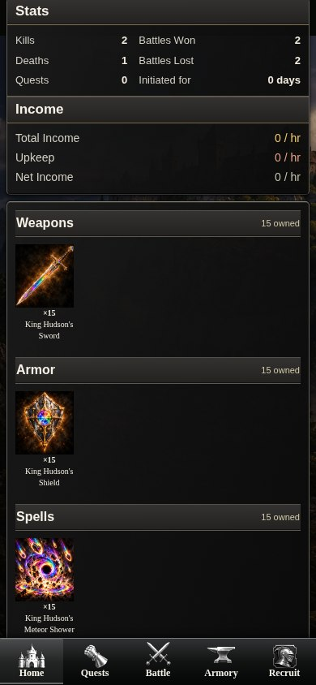

# Successful-claim statistics, uncapped human PvP loot and Hudson artwork

This draft corrects Kills/Deaths accounting, removes the ordinary human PvP gold ceiling and integrates the three available, owner-selected Hudson illustrations. **The additional authorized gameplay change removes only the ordinary human PvP gold ceiling.** Profile layouts, combat/damage/XP formulas, grants, bot policies, bounty economics, production records and release workflows are preserved. The experimental UI mockups at `b494730` are excluded.

## Accounting correction

| Display | Authoritative source |
| --- | --- |
| Kills | `champion_standings.bounty_claims` — successful claims made |
| Deaths | `champion_standings.bounty_deaths` — successful claims against you |
| K/D | The same two claim counters; existing finite-score/ranking rules remain |
| Battles Won / Lost | Existing independent battle outcome counters |

Migration 012 preserved older settled contracts as `bounty_kills` records. Migration 019 backfilled and maintains the claim counters only when a claim record matches a **claimed** contract's exact bounty, battle, claimant and target IDs. These counters already include both `legacy_claim` and `finishing_claim` sources. Profiles and the Kills/K/D leaderboards had instead selected migration 026's narrower HP-finishing counters, producing inconsistent totals.

The correction reuses the existing claim counters. Self/public profiles, the existing game API, Kills, Bounty Hunters, K/D and per-rival statistics now agree. A recorded claim counts even if its saved battle lacks modern Health fields or its battle calculation was a defeat. Ordinary victories, defeats and zero-Health knockouts contribute no Kills/Deaths.

No migration or live reconciliation command is necessary. No saved claim, combat result or payment is rewritten. The old `competitive_deaths`/`competitive_statistics` evidence and their guards remain intact; they no longer define displayed Kills/Deaths. The existing `verified_death` API evidence field is retained, with additive `recorded_claim` evidence for history text. Notifications and their read markers are unchanged.

Exactly-once accounting retains the existing bounty/battle uniqueness constraints, transactional claim payment, escrow/character locks and command-retry receipts. There is no union of old and new counters that could count a claim twice. Bounty claim eligibility itself is unchanged: this removes an **additional statistics gate**, not the existing combat/claim authorization.

Synthetic examples:

| Evidence | Previously displayed | Corrected |
| --- | --- | --- |
| Two completed claims made, no modern HP fields | 0 Kills | 2 Kills |
| One completed claim against that player | 0 Deaths | 1 Death |
| The same player's K/D | Unranked | 2.00 |
| Ordinary victory or defeat, including a knockout | No Kill/Death | No Kill/Death |
| Replayed/concurrent claim command | One completed claim | One Kill and one Death |
| Active/expired/canceled contract, mismatched claim identity | Unsupported | Not counted |

These are disposable fixture examples, not claims about inspected production totals. Successful historical bot-target claims also count; existing human-only leaderboard eligibility remains separate.

## Ordinary human PvP — no fixed gold ceiling

The owner additionally authorized removing the 15,000-gold ceiling. New attacking victories against human targets use immutable `human-pvp-loot-1`:

```text
base   = floor(exposed_wallet × 3 / 100)
loot   = floor(base × existing_pair_percentage / 100)
percentages = 100, 75, 50, 25, then 10
```

Both floors use BigInt arithmetic before safely returning the recorded integer amount. There is no replacement reward cap. The current safe wallet range and all balance protections remain intact. For example, a first win against 1,000,000 exposed gold transfers **30,000**; against 2,147,483,647 it transfers **64,424,509**. Vault, upkeep reserves and retained treasury are not exposed wallet funds.

The existing transactional debit and `creditGold` remain the only payment path. If the attacker lacks wallet headroom, the rest is credited in full to the existing journaled retained treasury; nothing is discarded. For example, with seven gold of wallet room, a 64,424,509-gold reward credits seven to the wallet and 64,424,502 to retained funds. The combined attacker gain exactly equals the defender's debit. This reuses existing accounting, with no new income/payment mechanism.

New battle/ledger/sequence records identify `human-pvp-loot-1`. Existing pair-window starts and victory counts continue without reset when their next victory uses the new policy. Historical capped rulesets, battle reports and receipts remain unchanged. All bot ceilings, 100/85/70/55/40 reductions and 65% XP remain unchanged. Human XP eligibility, damage, Health/Stamina costs, defeat behavior, normal matching and bounty authorization are unchanged. Bounty principal and listing fees remain separate from ordinary loot.

Tests cover exact two-floor rounding, safe-integer arithmetic, full wallets, retained-credit rollback, concurrent rich-target wins, duplicate commands, pre-cutover pair sequences, Vault protection, and a 30,000,000-gold ordinary transfer alongside an unchanged 1,000-gold bounty. The Rules page describes the uncapped human policy; capped helper tests and older research are explicitly historical.

## Integrated artwork — exact existing files

The new immutable `equipment-artwork-1` registry references byte-identical copies of the three previously prepared 512×512 lossless WebPs. Their original randomized-name owner PNGs, source commit, source hashes and all earlier registries are preserved.

| Stable ID | Displayed item | New runtime path |
| --- | --- | --- |
| `king-hudsons-sword` | King Hudson's Sword | `/assets/art/equipment-artwork-1/king-hudsons-sword.webp` |
| `king-hudsons-shield` | King Hudson's Shield | `/assets/art/equipment-artwork-1/king-hudsons-shield.webp` |
| `king-hudsons-meteor-shower` | King Hudson's Meteor Shower | `/assets/art/equipment-artwork-1/king-hudsons-meteor-shower.webp` |

Total added runtime artwork: **1,138,080 bytes**. No image generation, re-encoding, repainting, recoloring or modification of existing files occurred. [Exact hashes, provenance, missing-art inventory and preservation fingerprints](inventory-and-preservation.json).

The shared catalog-art partial resolves only these exact ID/name/category/level identities. Armory discoveries, self/public inventory, equipment disclosures and saved battle equipment use the same assets. Quest-only acquisition and existing level requirements remain intact; artwork does not make these items purchasable. Existing 15/15/15 quantities, grant receipts, account bindings and item-specific upkeep entitlements are untouched. Ordinary owners still pay standard upkeep.

Startup validates the immutable manifest digest, permitted paths, real paths, file sizes and SHA-256 hashes; missing, tampered or escaped assets fail closed. Selection is compiled code, with no request parameter, environment switch, endpoint, database artwork write or repeated expansion activation. This development PR does not authorize deployment.

## Four approved replacement sources still missing

| Stable ID | Intended replacement | Action in this PR |
| --- | --- | --- |
| `eclipse-citadel-plate` | Royal Garrison Plate — fortress-inspired armor | Preserve current source/path/hash |
| `sovereigns-zweihander` | Mountain Warden’s Zweihander — approved revised design | Preserve current source/path/hash |
| `eclipse-gatehammer` | Eclipse Gatehammer — white/gold | Preserve current purple source/path/hash |
| `eclipse-aegis` | Eclipse Aegis — white/gold | Preserve current purple source/path/hash |

The available repository files and supplied-source history contain the current illustrations and earlier candidates, not identifiable finalized replacement sources for these four directions. The owner explicitly instructed continuation without substitutes. Supply those four exact approved standalone files separately; none is generated, recolored or guessed here. All 52 coordinated assets remain byte-identical.

## Rendered verification

390px local screenshots: [self Profile](screenshots/390-self-profile.jpg) · [public Profile](screenshots/390-public-profile.jpg) · [ordinary owner](screenshots/390-ordinary-profile.jpg) · [weapon discovery](screenshots/390-armory-weapon.jpg) · [armor discovery](screenshots/390-armory-armor.jpg) · [spell discovery](screenshots/390-armory-spell.jpg) · [saved battle](screenshots/390-saved-battle.jpg).



The disposable Profile example shows two historical claims made and one against Hudson, while retaining the exact Stats → Income → Equipment layout and 15 owned copies per category. The ordinary owner example retains standard upkeep. No production account was read or changed.

Browser verification covers **28 actual views** at 320, 390, 430 and 1024px, plus **21 full-bleed icon crops** at 36×36, 60×60, 64×72, 76×76, 62×60, 68×61 and 128×112. No missing images, browser errors, overflow or artificial black edge strips. [Measured browser evidence](screenshots/verification.json).

## Tests and release boundary

Focused coverage includes legacy/missing-HP claims, unsupported evidence, self/public/API/ranking consistency, ordinary battle separation, concurrent/replayed claims, historical bot-target claims, asset identity/tampering/path rejection, 15/15/15 grant preservation and ordinary upkeep. A populated 450-bot upgrade/replay fixture preserves every existing business row and session. Historical beta-art tests keep their explicitly isolated old rendering assertions; current artwork is covered independently.

**46 focused tests pass across eleven files**, with zero failures or skips. TypeScript, build and static checks pass (99 checks, including 77 production EJS fixtures). [Focused results](focused-verification.json) · [450-bot populated preservation](populated-preservation.json). The exact-head GitHub CI run and aggregate result are linked in the draft PR, including the existing population, container, security, schema-026, encrypted recovery and restored-copy suites. No protected release workflow is dispatched.

The new immutable loot definition is installed by the existing ruleset-registration path; no SQL migration is introduced; the strict release pin stays `026_living_competition.sql`. This PR changes no protected workflow, backup/restore implementation, token, infrastructure configuration, bot identity, existing financial records, XP, item definition or approved profile design. Only the explicitly approved ordinary human gold ceiling is removed. Merge and deployment remain subject to separate owner review. No Hudson grant or artwork-adoption production command is executed.
