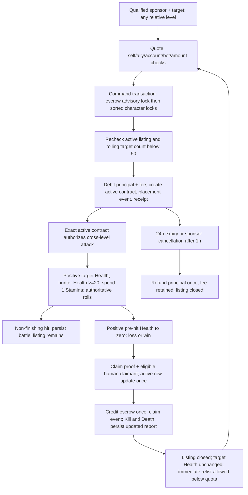
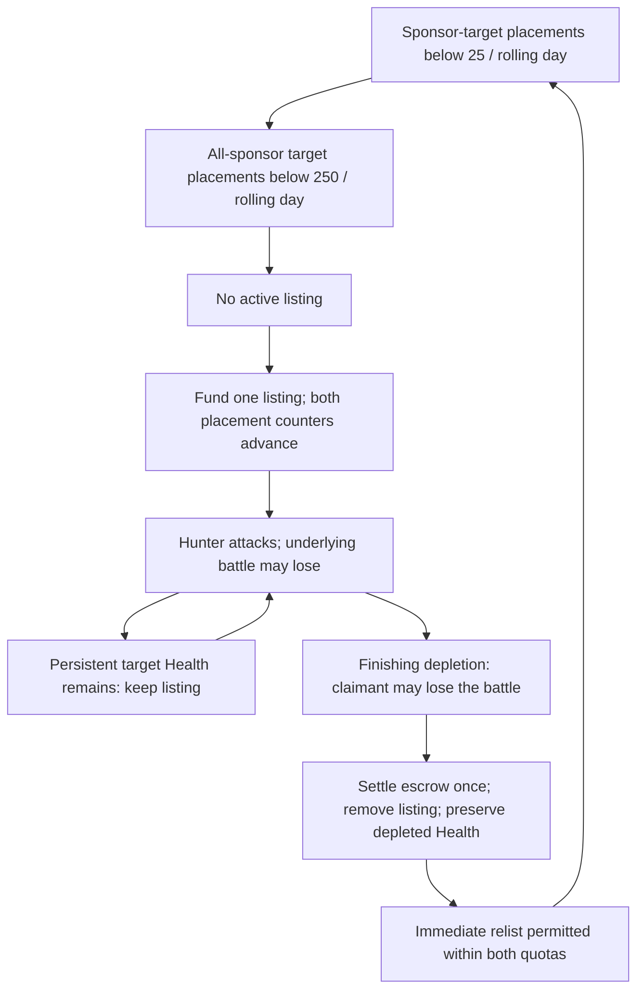

# Historical reconciliation and priority corrections

Owner review, October 26, 2026. Repository changes and disposable tests only.

**Pinned baseline:** `e9165c34ef8ddaba4e04488438ba110cc2020376`, resolved from `release/production` before editing. **Reference collection:** draft PR [#44](https://github.com/catillatio/test/pull/44), head `5e246718dd6410d410701ab1a5ad02f5bf97f771`. This branch does not merge PR #44. No production application, database, activation record, Railway settings or worker was accessed. Merged code is not evidence of deployment or activation.

## Executive findings

1. **Fixed: profile Land artwork.** `ownedProperties()` dropped catalog `level`. The coordinated artwork resolver deliberately requires exact ID, name and level. Marcher Stronghold therefore missed its approved image and fell through to the temporary beta castle image `/assets/art/level100-beta-1/land.webp`. All six expansion properties were affected by the same missing metadata. The profile now carries the catalog level; saved quantities and financial rates still come from holdings.
2. **Fixed: equipment framing.** Legacy atlas icons were sized by `.fantasy-art`; newer `` icons escaped that 58px inventory rule and retained their 76px dimensions. Separate source-specific rules also removed some borders. One shared equipment frame now applies to SVG, atlas cells, selected crops and approved images. Responsive square sizes, a single bronze border, centered proportional images and stable loading space apply per context. No source artwork was resized, cropped, regenerated or replaced.
3. **Fixed: cross-level sponsorship.** Both `bountyQuote()` and the final command handler independently reused ordinary `areRivals()` matchmaking. Both placement checks are removed; quote, profile link, confirmation and final transaction now agree. The existing onboarding floor (level 3 and five quests), valid enabled accounts, self/ally checks, bot flags, affordability, fee, escrow, one active listing and rolling target limit remain. Disabled human targets are explicitly rejected by the shared quote. Ordinary attacks retain their level range. Cross-level bounty hunts were already implemented and remain contract-authorized.
4. **Fixed: human XP allowance.** The rolling query counted `rewarded=true` losses. It now counts only `rewarded AND outcome='attacker_win'`. Three eligible losses no longer turn the eventual meaningful victory into 1 XP. Three full-eligible successful attacks against the same human still exhaust that directional allowance; trivial successful wins still count conservatively. Losses award zero attacker XP. The general request rate limit, real resource costs, defender budget, bot multiplier, bot repeat tiers and gold sequences remain.
5. **Reproduced: synthetic 78.3%.** Exactly 44,100 / 56,305 winning roll cases yield 1 XP (78.323417%). This is the earlier level-50 developing-build fixture, not production telemetry. The strength cliff dominates that sample. Three alternative curves were evaluated over 72 builds, six levels, both combat orientations, human proxies, bots and repeated victories. See [XP report](XP_REPORT.md).
6. **Already present:** losing finishing attacks can claim bounties, claims preserve depleted Health, Kills/Deaths represent claims rather than ordinary wins, bounty attacks cross levels, and eligible sponsor/target allies can hunt. These are tested existing behaviors, not new historical lifecycle changes in this branch.

## Evidence, integrity and overlapping work

Read: the Level-100 master plan; Phase 5.1A master backlog; combat/bounty decision study; progression, compatibility, equipment presentation and artwork registries; the PR #44 master context, README, collection and image indexes, original mechanics addendum and all 86 screenshot entries. Contact sheets were reviewed, with full-resolution checks of representative Land, quest, skill and bounty evidence. All 86 image entries decode and match their manifest SHA-256 values. Twelve contextual duplicates remain duplicated in the source collection; 74 distinct filenames are represented.

**Reference defect preserved:** the PR #44 collection manifest's original hash/size for `historical/knights-reforged/bounty-addendum/HISTORICAL_BOUNTY_AND_SKILLS.md` does not match its later clarified text at the pinned PR head. The current text includes section 8 and a note about eight later screenshots outside the collection. This audit uses the actual pinned text, records both hashes in [reference verification](reference-verification.json), and does not repair or overwrite PR #44's manifest. The later eight screenshots are unavailable here; the reported 590/1 and 11/846 builds are owner-provided claims, not inspected images in that manifest. Inspected images independently show 287/1, 258/1, 2/396 and 64/313 specialization.

Evidence vocabulary:

| Label | Meaning |
|---|---|
| Direct historical evidence | Visible values or actions in a historical screenshot; no recovered server algorithm |
| Player-confirmed | Firsthand testimony preserved by the owner, including 25/250 placements and 3 SP/level |
| Inferred | Interpretation, such as the likely relationship between displayed purchase price and ownership |
| Unverified | Missing evidence, deployment state, exact old HP floor or internal algorithm |
| Current implementation | Source/test-derived Kingdom Come behavior; never proof of historical accuracy |

Open PRs at inspection: #44 reference import, #20 Android shell, #13 isolated owner operator. None is merged here. Gameplay PRs #31–43 are merged; #33/#34/#36 contain compatible expansion/presentation machinery, #37/#38 artwork installation/adoption, #40/#41/#42/#43 competition and profiles. PRs #45–53 are merged recovery/registrar work. Their protected logic, identities, files and settings are untouched. The old master-context description of #25 as draft is stale; it is now merged. A historical planning document saying a feature is pending does not override current code or authorize activation.

## Mechanics comparison matrix

Historical filenames below resolve under the pinned [PR #44 collection](https://github.com/catillatio/test/tree/5e246718dd6410d410701ab1a5ad02f5bf97f771/knights-reforged/docs/visual-references). Confidence describes the historical claim, independently of confidence in inspected code.

| Mechanic | Historical behavior | Current source behavior | Evidence | Confidence | Severity | Correction | Status | Risk |
|---|---|---|---|---|---|---|---|---|
| Land profile imagery | Distinct property illustrations | Six expansion properties lose exact resolver level metadata | Owner screenshot; profiles.ts; coordinated-artwork.ts | Confirmed current defect | High visual | Carry catalog level | Fixed | Presentation only |
| Equipment imagery | Compact consistent category icons | Source class determines size/border | Owner screenshot; refinements.css; phase49.css | Confirmed current defect | High visual | Shared frame | Fixed | Layout, silhouette |
| Bounty sponsorship levels | Broad sponsorship intent; exact original range not independently recovered | Ordinary rival range imposed twice before patch | commands.ts; bounties.ts; owner requirement | Historical unknown; authorization explicit | High gameplay | Separate placement from matchmaking | Fixed | More cross-level funding, existing limits retained |
| Ordinary PvP range | Similar-level lists shown | abs(A−B) ≤ min(max(2,ceil(.2A)),max(2,ceil(.2B))) | 1000032205; areRivals | Formula unknown historically | Medium | Preserve current | Retained | Targeting protections |
| Bounty hunt range | Cross-level encounters in historical captures | Exact active contract permits cross-level hunt | 1000031962/2063/2064; phase6-combat | Confirmed visible; full original rule unknown | High | Preserve already implemented | Retained | Contract spoofing/race |
| Sponsor-target quota | 25 placements/rolling 24h | No sponsor-pair placement quota | Addendum testimony; placementAvailable | Player-confirmed | High | New versioned quota design | Proposed | Multi-account pressure; old events count policy |
| Target quota | 250 placements/target/24h | 50 across all sponsors, ended contracts included | Addendum; 1000030968/2061; bounties.ts | Player-confirmed numbers; screenshots corroborate errors only | High | Review 25/250 together | Proposed | Abuse and compatibility |
| Active listing | One until claimed | One active; also expiry/cancel paths | Addendum; partial unique index; tests/bounties | Player-confirmed | Medium | Preserve current until policy review | Retained | Concurrent placement |
| Losing finishing claim | Finishing attacker may lose battle and claim | Already supported; no battle-win predicate in claim query | Addendum; claimBounty; phase6-combat | Player-confirmed | High | No rewrite needed | Verified existing | Exactly-once escrow |
| Non-finishing attacks | Listing remains | Already remains active | claimBounty proof; tests/bounties | Player-confirmed | High | Preserve | Verified existing | False kill credit |
| Victim Health after claim | No automatic heal | Stays depleted; defensive XP never refills | Addendum; combat.ts | Player-confirmed | High | Preserve | Verified existing | Revival/extra claims |
| Zero-Health relisting/attack | Immediate relisting and rapid next claim recalled | Placement at zero allowed; attack requires positive target Health | Addendum; combat.ts; bountyBoard | Player-confirmed; exact old floor unknown | High | Separately design HP-floor/finishing semantics | Proposed | Must not pay from stale hit |
| Claim cancellation/expiry | Full old rules not evidenced | 24h expiry; cancel ≥1h; principal refunded, fee burned | bounties.ts | Unknown historically | Medium | Keep current | Retained | Refund/claim race |
| Kills and Deaths | Separate from battle W/L | Authoritative completed claims, including legitimate legacy claims | Profiles; PR #43; competitive-records.ts | Confirmed visible distinction | High | Preserve PR #43 | Verified existing | Historical statistics |
| Human attacking XP budget | Original repeat formula unknown | Three full-eligible wins per opponent/rolling day after patch | combat.ts; new regression | Unknown historically | High | Exclude losses | Fixed | Pair collusion still possible |
| Defensive XP | Victories visible in feeds; exact award algorithm unknown | Three full nontrivial defensive wins per pair; then 1 | 1000032053; combat.ts | Direct messages, formula unknown | Medium | Preserve | Retained | Passive farming |
| Strength cutoff | Original formula unknown | r<.35 forces 1 XP | gameplay-rules.ts | Unknown historically | High | Compare smooth curves | Offline proposal | Easy-target farming |
| Bot XP | No historical bot-policy evidence | 65%, two floors; repeat 100/85/70/55/40 | bot-combat-rules.ts; bot-experience.ts | Current only | Medium | Preserve approved policy | Retained | Disposable-target farming |
| Skill points | 3 per level testified | 1/level plus discrete milestones/achievements | Addendum; progression.ts | Player-confirmed | High fidelity | Separate entitlement/formula design | Proposed | Existing allocations/migration |
| Attack/Defense allocation | Extreme specialization visibly possible | 1 point/rating, +1% army power, capped 25 each | 1000031965/0970/2070; allocateSkill | Direct specialization; old power effect unknown | High fidelity | Model uncapped alternatives separately | Proposed | Major combat rebalance |
| Resource starts/caps | Recalled starts uncertain; screenshots show varied builds | 100 Health, 20 Mana, 3 Stamina; max 5000/500/100 | alpha resources; addendum | Starts unverified historically | Medium | Preserve | Retained | Existing entitlements |
| Resource allocations | Attribute increase controls visible | 1 SP→10 Health or 1 Mana; 2 SP→1 Stamina | progression.ts | Conversion unverified historically | Medium | No formula activation | Retained | Build viability |
| Participating army | 5×level maximum; 630/685/735/755 seen | Legacy min(101,max(1+2L,legacy floor)); expanded max(5L,legacy floor), bounded by actual members | 1000032076; compatibility-rules.ts | Direct 5× recruit text; screenshots | High | Respect existing compatible engine | Already coded, activation unverified | No free members/copies |
| Equipment supply | Hundreds of actual copies shown | Per category, at most actual copies and participants; distinct attack/defense selection | Profiles; alpha selectEquipment | Direct quantity display | High | Preserve | Retained | Imaginary supply |
| Purchase unlock vs owned use | Exact original retiering rules unknown | Catalog/presentation separated; owned items retained | equipment-presentation.ts; catalog-compatibility.ts | Current only | High | Preserve approved mappings | Retained | Item identity/quest locks |
| Land identities | Plantation, Garrison, Trading Port, Castle, Settlement, Coal Mine; Kingdoms Live Blacksmith/Temple/Village/Shipyard/Keep | 21 classic / 27 expanded original Kingdom Come definitions | 1000032230/2203; catalog snapshot | Direct names/values | Medium | Document, no forced rename | Proposed fidelity review | Saved IDs/receipts |
| Land scaling | High owned counts and displayed prices visible | ceil(base × 1.1^owned); cap 100/type | 1000032230; propertyPrice | Scaling formula unknown historically | High economy | No price rebalance | Retained | Exponential costs |
| Income/upkeep | Gross/upkeep/net lines visible | Saved rates; one shared 60-minute cursor; maintenance reserve/arrears | Profiles; estate.ts; maintenance.ts | Direct totals; original settlement unknown | High economy | Preserve authoritative clock | Retained | Duplicate/offline payments |
| Quest rewards | Fight Soldier: 1 Mana, 3–5 gold, 1 XP; lumber 3 Mana, 8–17 gold, 3 XP and item requirement | Patrol: 2 Mana, 8–12 gold, 4 XP; authored 40/58 quests | 1000032206; catalog snapshot; commands.ts | Direct values | Medium | No economy changes | Proposed fidelity review | Progression bottlenecks |
| Player social identity | Unicode, emoji, comments and personal battle/bounty messages | UUID identity, safe names, comments, blocks/reports, personal feed, search and rivalry history | Social/profile captures; feeds.ts; competition.ts | Direct UI evidence | Medium | Preserve; address remaining UX separately | Retained | Moderation/privacy |
| Navigation | Home/Quests/Battle/Armory/Recruit | Same five destinations; bounty board within Battle | Historical captures; primary-nav.ejs | Direct | Medium | No duplicate boards/tabs | Retained | Navigation regressions |
| Level horizon | Leaderboard >300 visible | Authored content through 50 or expanded 100; progression arithmetic can continue above content horizon | 1000032238; progression-policy.ts | Direct historical display | Medium | Do not confuse content horizon with hard level clamp | Unchanged | Sparse late opponents |

## Land resolution and equipment details

Path: `contentCatalog(state.rulesetId).properties` → saved holding grouping in [`ownedProperties`](../../src/profiles.ts) → `profileProperties` in both self/public routes → [`profile-land`](../../views/partials/profile-land.ejs) → [`catalog-art`](../../views/partials/catalog-art.ejs) → approved equipment/coordinated/regional/presentation/expansion/atlas/SVG resolution → `/assets/` static plugin → CSS → browser. The Land marketplace passed full catalog definitions already; it therefore worked while profiles failed.

Marcher Stronghold is stable ID `marcher-stronghold`, level 56, approved path `/assets/art/regional-weapon-land-1/marcher-stronghold.webp`, native 768×512. No missing file, filename-case mismatch, stale URL or cache failure was needed to reproduce the defect. Carrying `level` restores the existing approved resolver. Royal Border Fortress, Crown River Port, Imperial Siegeworks, Sovereign Castle and Eclipse Crown Citadel have the same metadata dependency. All 27 profile definitions are tested, including the visible Silver Vein Mine through Worldroot Bastion. Unknown historical IDs retain their name, saved rates and intentional existing fallback; no substitute artwork is invented.

The [decoded asset inventory](asset-inspection.json) reads 129 runtime raster files: 81 are 512×512, selected crops include 208×208, Land includes 768×512, and atlases include 960×1200/960×1440. One runtime raster has nonopaque pixels. File extension alone was not used to infer transparency or native size. Atlas backgrounds keep their existing cell coordinates/background-size; standalone images use `object-fit:contain`. All are inside a single external frame. No atlas is treated as a standalone image.

[`equipment-images.css`](../../public/equipment-images.css) is loaded after existing source-specific styles, with a new immutable UI revision URL. Contexts: inventory 58px; compact battle 48px / desktop 64px; bulk 54px; inline requirement 25px; Armory 62px narrow / 68px normal / 128px desktop. Profile quantities are below centered icons. Existing 44px Bulk links have reserved space and do not overlap art. CSS is shared by profiles, owned discoveries, catalogs, purchases, receipts, bulk dialogs, quest requirements and saved battle equipment. Historical unknown equipment still uses its intentional unknown presentation. No item ID, display-name mapping, economic stat, quantity, acquisition lot or receipt changes.

## Bounty lifecycle, transaction and compatibility analysis

Current implemented state machine (the placement range check is the only changed lifecycle eligibility):



Owner-confirmed historical conceptual model (not an original server implementation):



Historical concurrency/rollback internals are unverified. The future implementation must preserve current `executeCommand()` transaction ownership, `lockBountyEscrow()` advisory lock **before** sorted character locks, row/unique guards, receipt idempotency and ledger atomicity. Current `claimBounty()` requires a server-saved battle from within the contract lifetime, positive pre-hit target Health, post-hit zero Health and real Stamina spent. It atomically changes active→claimed, credits `creditGold()`, records one event and one bounty-kill identity. It does not require `attacker_win`. DB triggers and competitive-record readers further constrain K/D. Cancellation, expiry and claim share the established lock order; errors roll back debits, payouts, stats and receipt together. A retry returns the saved command result. No old hit may claim a freshly relisted contract.

Changing 50→250 is not a one-number fidelity fix: a sponsor-pair 25-placement rule, ended/cancelled/expired placement counting, exact boundary semantics, bot policy and zero-HP finishing proof need one reviewed versioned design. All old bounties retain their recorded policy and escrow. The current positive-before→zero proof cannot support a zero→zero repeat claim; weakening that proof would risk free or duplicate payouts. No inactive partial financial lifecycle is installed here.

## Combat and skill formulas

Sources: [`stateFrom`](../../src/game.ts), [`selectEquipment`, `trainedPower`, `resolveAlphaCombat`, `areRivals`](../../src/alpha-rules.ts), [`callingPower`](../../src/strategy-rules.ts), [`resolveBattle`](../../src/combat.ts), [`executeCommand`](../../src/commands.ts), [`grantExperience`, `allocateSkill`](../../src/progression.ts), [`advanceProgression`](../../src/progression-policy.ts).

For each mode, select actual owned usable copies, sorted by that mode's stat, secondary stat, upkeep and stable ID. At most one weapon, armor and spell per real participating member; paused upkeep gear is excluded. `participants=min(capacity,1+retained militia+accepted allies)` (expanded registered bot contingents are actual saved members). Legacy bot caps and expanded cohort rules remain distinct.

```text
untrained attack  = 5 + 2(L−1) + (participants−1)×unit.attack  + selected attack
untrained defense = 5 +   (L−1) + (participants−1)×unit.defense + selected defense
trained power = round(base × (100 + rating) × 100 / 100) / 100
final power = callingPower(trained power, calling percentage)
rolled attack/defense = round(final power × (100 + uniform integer roll[−10,+10]))
attacker wins iff rolled attack > rolled defense; a tie favors defense
gap = abs(rolled attack−rolled defense)/100
loser damage = min(30, 12 + floor(gap/2)); winner damage = 3
post-hit Health = max(0, pre-hit Health−damage)
```

The selected `rules.unit` contributions are 3 attack / 2 defense per militia participant. Barbarian: +4% attack, −2% defense, Stamina recovery interval −10%; Tank: −2% attack, +4% defense, Health interval −10%; Mage: −2% both powers, Mana interval −10%. Calling arithmetic uses the existing hundredth precision. Attacks cost 1 Stamina and need 20 Health; target Health must be positive. No new cooldown is introduced. These reconstructed formulas are not claimed historical.

Only attacking victories transfer ordinary loot. Human loot uses `human-pvp-loot-1`: floor(3% exposed wallet) then pair 100/75/50/25/10; no fixed human cap. Bot loot retains its existing capped, level-based 100/85/70/55/40 policy. Vault, maintenance reserve and retained treasury are not exposed loot. `recordVictory()` advances only victories in a fixed 24h pair window; XP's human rolling window is separate. Defensive wins award XP but no ordinary gold. Both parties' persisted state, progression, snapshots, loot, bounty claim, statistics and receipt are in the command transaction. See XP report for reward formulas and the exact allowance query correction.

Current skills: one ordinary SP per gained level; milestones and first-victory/quest awards add points separately. One SP buys one Attack/Defense rating, capped 25; Health +10 or Mana +1 costs one, Stamina +1 costs two. Starts are 100/20/3, with max capacities 5000/500/100. No respec or reset is added. Displayed historical Attack/Defense attributes do not establish their original combat multipliers. A 590-rating build cannot be represented by the current capped rating system; changing that requires comparing legal extreme, balanced, army-heavy and gear-heavy builds and preserving old point entitlements.

## Economy, equipment, quests and social review

[Catalog snapshot](catalog-snapshot.json) preserves the full numerical comparison input: 60 legacy / 99 expanded items; 40 / 58 quests; 21 / 27 properties. It includes current presentation names, stable IDs, stats, unlocks, prices, upkeep, energy, equipment prerequisites and rewards. No definitions are modified.

Historical examples: Kingdoms Live Blacksmith 14,000/250 income, Temple 50,000/800, Village 100,000/1,400, Shipyard 180,000/2,200 and Castle Keep 320,000/3,200 are shown with zero owned in `1000032203.jpg`. Knights Reforged `1000032230.jpg` instead shows Plantation 1.5m at 758 owned/income 200; Garrison 3.2m at 794/income 500; Trading Port 5.8m at 574/income 1,200; Castle 9.1m at 499/income 1,900; Settlement 9.7m at 285/income 2,800; Coal Mine 16.4m at 290/income 4,000. These are two different reference series and must not be merged into one invented catalog.

Current scaling is `price(n)=ceil(base×11^n/10^n)`, each copy quoted separately. Example: Smallholding base 45 gives 45, 50, 55 at owned 0/1/2; Silver Vein Mine base 3,600 at owned 27 quotes ceil(3600×1.1^27), approximately 47,196, not 3,600. A 1.5m price at 758 owned cannot reasonably be compared as a base price: under the **current** 10% model the multiplier is about 2.4×10^31. That contradiction establishes that the old displayed price/ownership does not support importing today's exponential model into history. Original scaling/unlocks/upkeep/suspension and ownership limits remain unknown unless individually evidenced. Current per-type limit 100 differs from historical visible hundreds; no limit change is installed.

The supplied current owner screenshot's contribution arithmetic is consistent with saved holdings: Silver Vein Mine 27×310=8,370 gross and 27×35=945 upkeep; Marcher 1×4,200=4,200 and 1×600=600. Profile fixes use those saved totals, not recalculated catalog costs. `estateState()`, `settleIncome()` and maintenance settlement retain one shared hourly cursor, prorating, fractions, offline catch-up, ledger receipts, arrears and reserve funding. Existing automatic-upkeep machinery is reviewed as code, not newly activated from backlog notes. No second payment clock or financial migration is introduced.

Equipment names/art are intentionally original Kingdom Come identities. No historical art is copied into runtime. The presentation layer preserves the planned Runescar Saber→Stormglass Pike, Verdant Aegis→Argent Sentinel Plate and Silverroot Ward→Runic Convergence relationships. Current presentation remapping does not change purchased numerical identities. Future purchase-unlock movement must keep owned-use and server-resolved quest alternatives; otherwise a newly progressing account can encounter a required item it cannot buy. Existing compatibility/expansion tests cover that architecture. This branch does not retier gear or install quests, rare drops or level requirements.

Historical quest values above differ from Kingdom Come's Patrol 2 Mana/8–12 gold/4 XP and Gather Timber 3 Mana/12–18 gold/6 XP/one Squire's Blade. Current repeated quests use server validation for unlocked level, real equipment, discoveries, army and Mana, then saved random gold, progression and quest-run records. The expanded 58-quest catalog retains alternative requirements and authored late content. Exact historical success/failure rolls and all unlocks are not recovered. No reward-economy tuning is inferred from a screenshot.

Existing five tabs, personal Home feeds, dedicated Broadcasts view, profile comments, safe Unicode/emoji, player search, paginated battle tales, rivalry records, recruitment and notifications remain. Kills leaderboard and XP standings use persisted records. Public profiles do not expose private battle snapshots; saved reports remain combatant-only. Blocking/reporting does not become automatic combat immunity. No duplicate bounty board, global bot feed filler, speculative clan mechanic or new reputation currency is added.

## Compatibility, deployment and owner decisions

No schema migration or persistent-state conversion is needed for these corrections. Attained levels, XP balances, skill allocations, gear IDs/copies, property holdings, wallets/Vaults, purchase costs, receipts, escrow, old battle JSON, bot identities, comments, achievements and historical K/D are untouched. Existing histories keep their original `rewarded` flags, results and policy identities; the corrected prospective query simply excludes loss outcomes. Old full-eligible successful victories continue to count. No backpay or historical XP recomputation occurs.

Rolling releases can temporarily serve old/new visual CSS and old/new placement or XP counter behavior. A client may see a permissive placement form then reach an older worker that rejects it, or a battle routed to an older worker may still count losses. Neither version permits extra escrow payment or reward races because the existing locks/receipts remain. Owner release planning should drain old workers or confirm their retirement before claiming consistent new behavior. No production cutover is performed. New CSS has a distinct revision URL; old images retain their approved immutable URLs.

Bots keep 65% XP and their victory-only repeat sequence, finite actual wallets/equipment/Land and all population/autonomy flags. The 900-entry synthetic cohort is not live observation. Nothing provisions bots or changes bot capital. Recovery copies, both emergency OIDs, registrar settings/manifests/pins, protected identities, release workflow and approval logic are unchanged.

| Decision class | Scope | State |
|---|---|---|
| Already authorized | Verified visual defects; cross-level placement | Implemented in draft branch; not merged/deployed |
| Conditionally authorized, verified here | Losses consuming successful-victory allowance | Narrow source correction and rollback/concurrency regressions; same three-win safeguard |
| Approved architecture, activation unverified | Existing expansion compatibility/presentation and 65% bot policy | Preserved; no activation |
| Requires explicit approval | New numerical XP curves, cap, bot percentage, progression slope changes | Offline research only; no runtime selector installed |
| Requires explicit approval | Historical 25/250 quotas, zero-HP repeated finishing semantics | Proposed separate versioned financial/lifecycle design |
| Requires explicit approval | 3-SP entitlement, uncapped skills, combat formulas, ownership limits, quests/economy | Audit/proposals only |
| Requires explicit approval | Any merge, deployment, migration, bot activation/capitalization | Not performed |
| Unresolved historical questions | Exact old HP floor, original damage/skill/XP equations, complete property scaling/unlocks, exact quest success rules | Evidence gap; do not ask owner to reconfirm established testimony |

Recommended next phase: review this draft's four corrections and release evidence; then design 25/250 placement accounting and the zero/low-Health finishing proof together, with synthetic rollback/race/relist rehearsal. In parallel review hybrid XP's fresh-target farming exposure before any balance activation. After that, reconcile skill entitlements/combat contribution, then army/late progression availability, then remaining equipment/property/quest fidelity and social refinements. None of those recommendations authorizes deployment.

See [verification and reproduction](VERIFICATION.md), [XP report](XP_REPORT.md), complete [compressed results](xp-results.json.gz), [summary](xp-summary.json), [asset inspection](asset-inspection.json), [catalog input](catalog-snapshot.json) and [reference integrity](reference-verification.json).
