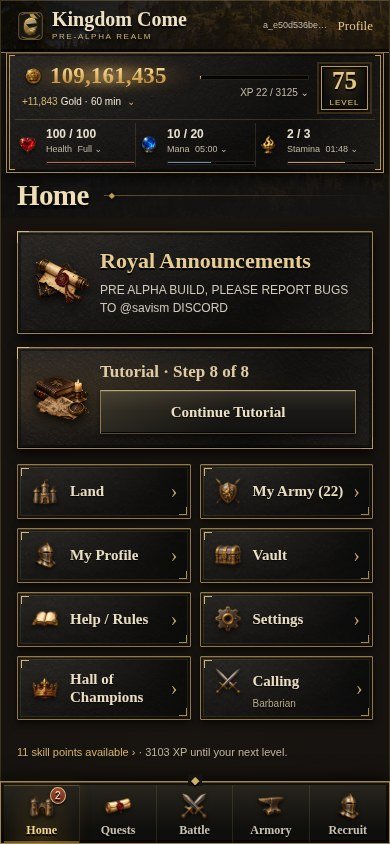
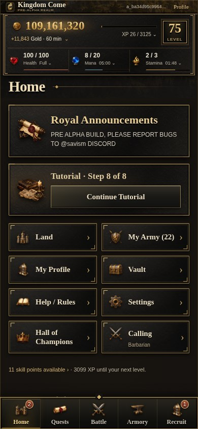
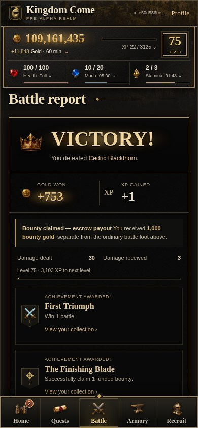
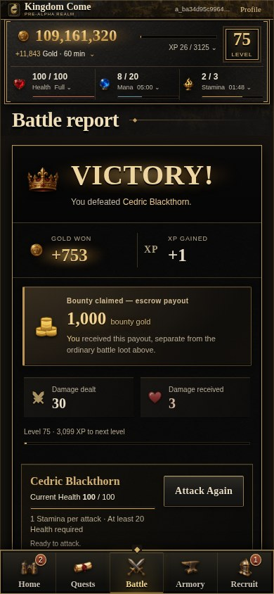

# Kingdom Come — final Iron & Brass beta review

The approved design now renders by default in normal application startup, including production-mode authentication, errors and secondary pages. This change prepares activation through the existing protected release; it does not merge or deploy the game.

[Browse all screenshots](SCREEN_GALLERY.md) · [Interactive before/after gallery](comparison.html) · [Complete route and state audit](SCREEN_COVERAGE.md) · [Screenshot inventory](SCENE_INVENTORY.json) · [Browser verification](verification.json)

| Home — previous beta | Home — final refinement |
| --- | --- |
|  |  |

| Claimed bounty — previous beta | Claimed bounty — final refinement |
| --- | --- |
|  |  |

## Final visual changes

- The branded masthead is approximately half its previous height: 28px on mobile and 30px on desktop, down from 53px and 58px. It can grow with text instead of clipping. The account link stays contained, resources retain their original values and disclosures, and the five gameplay tabs remain unchanged.
- Blackened iron and warm charcoal surfaces share restrained aged-brass framing, readable ivory type and consistent forged-metal controls. Mana retains its functional blue indicator; panels and navigation use the neutral palette.
- Bounty escrow has a dedicated compact reward panel with a clear amount, coin emblem and recipient. It remains visibly and numerically separate from ordinary battle loot. Damage dealt and received have distinct icons, stronger numbers and compact two-column grouping.
- The existing repeat-attack control sits directly after rewards/progress, before equipment comparisons, so repeated combat remains quick. XP, achievements, equipment, battle details and restrictions remain present.
- Vault, Settings, Bounties and confirmations, Champions, Achievements, Tutorial, quest requirements, receipts, authentication and error pages use the same consolidated materials, typography and control sizing as Home, markets and profiles.
- The centered gold and Victory underlights retain their geometric centering checks. Approved equipment and property images, quantities and identity mappings are unchanged. No new artwork was generated in this final pass.

## Implementation boundaries

Presentation changes are in the existing layered `public/realm-iron-brass.css`, not another stylesheet override stack. `views/layout.ejs` selects that consolidated sheet for normal rendering and uses the `iron-brass` body class.

`views/report.ejs` has the necessary semantic markup for the bounty reward and damage groups. Decorative icons are inside their definition terms; the original payout, loot, XP and damage bindings remain. The existing attack-again partial is moved earlier without duplicating or changing its form, command, eligibility or cost.

The small `createApp()` composition change enables the theme for signed-in and signed-out views. `src/legacy-theme-preview.ts` permits the historical stylesheet comparison only through an internal test option on loopback; it rejects production and development configurations. There is no public theme/debug switch, query parameter or cookie.

No gameplay formulas, command handlers, routes, database schema, accounting, ownership, artwork registry or production infrastructure are changed. The test fixture deliberately executes existing commands on disposable synthetic data to verify interactions.

## Coverage and verification

The audit follows actual render callers and HTTP contracts: **21 live templates out of 22 declared templates**. The remaining `trade-confirm` template has no reachable render caller; its existing buy/sell EJS contract is still tested, rather than inventing a route. Fourteen JSON-only endpoints and navigation redirects are checked separately.

The browser matrix includes **420 paired view/state comparisons** at **320, 390, 430, 1024 and 1280px**, plus 35 glow-centering cases. It checks matching content, form contracts, navigation, resource readings and approved image references; decoded artwork; no horizontal overflow; compact header fit; and unchanged business rows before explicit interaction tests. Saved battle records independently supply the expected loot, bounty and damage values.

Native interaction checks exercise purchases, market Buy/Sell keyboard tabs, equipment previews, resource disclosures, broadcast, notification acknowledgement, conserved Vault transfers, persisted sound settings and the existing Register → Tutorial → Calling → Sign Out → Sign In journey. Production-mode SSR covers every reachable HTML template, including POST confirmations and authentication errors, against the disposable database with a secure production origin.

Primary actions and navigation retain 44px targets. The compact account link retains at least the WCAG 2.2 AA 24px target minimum. Reduced-motion, forced-colors and keyboard-focus treatments remain in the design system.

CI partitions the same five-width matrix into mobile and desktop entries within the existing browser lane and time limits. No assertions or viewport coverage are skipped to shorten CI. The normal all-width capture command remains the source of the committed review evidence.

## Screenshot provenance

Core **before** images are actual captures from the preceding beta commit `fb6626b728d5a01678dcb9c6f19e63aca1c8397c`, archived with byte hashes in [beta-before/PROVENANCE.json](beta-before/PROVENANCE.json). Their fixture represents the prior review and can have different balances or XP from the expanded final fixture. Numeric preservation is established separately through same-fixture assertions and saved battle records.

Secondary screens without prior-beta captures use the unchanged template with the internal classic stylesheet baseline. The gallery labels this distinction. In particular, a current report rendered with classic CSS is not presented as a historical report screenshot after markup changes.

All images are actual Chromium captures of the app, using synthetic accounts in a local disposable database. No production data, recovery copy or generated screenshot mockup is involved. Existing proposed Home UI art remains documented in [ASSET_PROVENANCE.json](ASSET_PROVENANCE.json); this pass preserves those assets and all approved equipment/property art.

## Reproduce in a private cloud workspace

With dependencies, Chromium and a designated **local disposable** PostgreSQL database ending in `_test`, run `npm run preview:realm-theme` from `knights-reforged` with `TEST_DATABASE_URL` set to that fixture. It prints loopback URLs for the normal theme on 4100 and internal legacy comparison on 4101, plus synthetic sign-in details. Ctrl+C removes only its fixture schema. The helper rejects production databases.

`npm run test:browser:home-theme -- --capture` runs the complete five-width matrix and regenerates the main screenshot evidence. Partial viewport modes cannot overwrite the documentation capture. The screenshot inventory identifies the additional narrow-width review captures.

## Remaining deployment boundary

Owner visual review, merge and a separately authorized protected image release remain. No Railway setting, database migration, storage change or new infrastructure is needed to activate this UI. After deployment, verify the real production Home, a battle report, markets, profile and signed-out authentication pages through the existing release health and review process.
