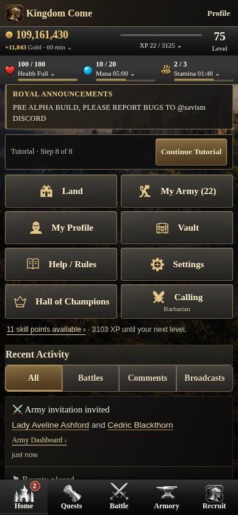
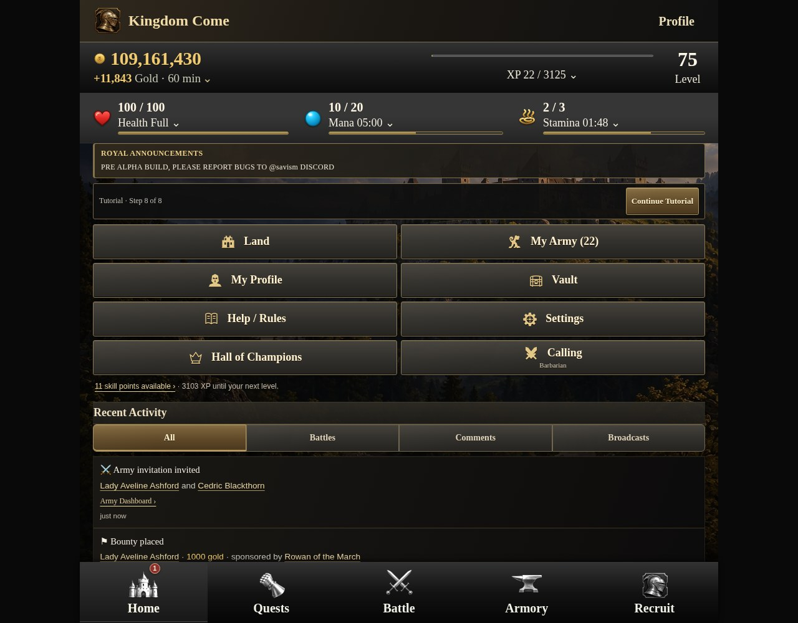
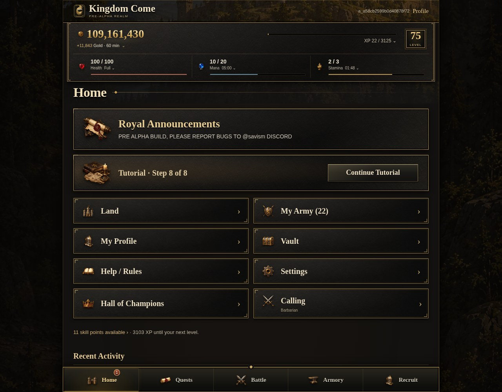

# Kingdom Come — Iron & Brass review

A shared presentation review using the owner's image for material and framing direction. It now covers Home, Quests, Battle/rivals, victory/defeat, Armory weapons/armor/spells, Land, self/public Profile and Army. [Open the interactive before/after comparison](comparison.html).

The existing Home structure, content, copy, eight menu links, tutorial forms, resource disclosures, activity feed and five-tab navigation are retained.

| Mobile — current | Mobile — Home review |
| --- | --- |
|  |  |

[Complete mobile Home: current](screenshots/390-before-full.jpg) · [review](screenshots/390-after-full.jpg)

| Desktop — current | Desktop — Home review |
| --- | --- |
|  |  |

[Complete desktop Home: current](screenshots/1280-before-full.jpg) · [review](screenshots/1280-after-full.jpg)

## What changed

- Compact masthead (53px mobile / 58px desktop), a metallic-gold balance with a broader feathered underglow, and restrained dark-metal action buttons.
- New sculpted brass/iron icon atlases, jeweled resource symbols, royal dispatch and candlelit tutorial illustrations, and subdued hammered iron texture. These are proposed Home UI decorations; approved equipment and property artwork remains untouched.
- Warm charcoal and blackened iron surfaces; aged brass frames, restrained corner details, deeper shadows and ivory/gold type.
- The existing castle illustration supports the compact masthead and Home title; it does not become a new hero section.
- The same gold, XP, level and three resource readings sit in an inset metal frame. Native interactive disclosures and recovery timers remain.
- Victory and defeat retain distinct outcomes; Victory uses a black base with subdued gold backlighting and a diffuse reward glow. Attack and Buy use dark forged-metal faces with fine brass edges.
- Royal Announcements and Tutorial have richer, distinct panel surfaces. The tutorial still uses the existing buttons and command forms.
- All eight menu tiles retain their destinations and labels. The new sculpted UI icons use explicit route mappings; original SVGs remain in the DOM and render in forced-colors mode. Calling still shows its existing class label.
- The same five bottom tabs receive bronze framing, clearer selected states and readable badges. The account name fits within its header instead of overflowing.

[New UI asset provenance and mapping](ASSET_PROVENANCE.json): four optimized WebP atlases total 198,572 bytes. The unmodified generated PNG originals are retained in `source-art/`, outside production assets. Processing is limited to aspect-fit atlas packaging and format/size optimization; the illustrations are not recolored or redrawn.

## Other screens

| Screen | Mobile review | Desktop review |
| --- | --- | --- |
| Battle / Rivals | [390px](screenshots/390-battle-after.jpg) | [1280px](screenshots/1280-battle-after.jpg) |
| Victory | [390px](screenshots/390-victory-after.jpg) | [1280px](screenshots/1280-victory-after.jpg) |
| Defeat | [390px](screenshots/390-defeat-after.jpg) | [1280px](screenshots/1280-defeat-after.jpg) |
| Weapons | [390px](screenshots/390-weapons-after.jpg) | [1280px](screenshots/1280-weapons-after.jpg) |
| Armor | [390px](screenshots/390-armor-after.jpg) | [1280px](screenshots/1280-armor-after.jpg) |
| Spells | [390px](screenshots/390-spells-after.jpg) | [1280px](screenshots/1280-spells-after.jpg) |
| Land | [390px](screenshots/390-land-after.jpg) | [1280px](screenshots/1280-land-after.jpg) |
| Profile | [390px](screenshots/390-profile-after.jpg) | [1280px](screenshots/1280-profile-after.jpg) |
| Public Profile | [390px](screenshots/390-public-profile-after.jpg) | [1280px](screenshots/1280-public-profile-after.jpg) |
| Army | [390px](screenshots/390-army-after.jpg) | [1280px](screenshots/1280-army-after.jpg) |
| Quests | [390px](screenshots/390-quests-after.jpg) | [1280px](screenshots/1280-quests-after.jpg) |

Full victory and defeat captures, matching before images, and regional equipment/Land details are available through the comparison viewer. Approved equipment and property illustrations retain their existing identities and colors; the neutral palette applies to the UI surfaces.

## Scope and markup

Existing page templates, shared header/resources/navigation partials, browser scripts, approved equipment/property images, routes and gameplay code are unchanged. The only template edit is in `views/layout.ejs`: select one consolidated shared stylesheet and add a review class when the internal UI preview is enabled. No product content is added or removed.

`src/ui-theme-preview.ts` and the small composition hook in `createApp()` restrict the review to an explicit test-only, loopback opt-in. There is no public query, cookie, environment switch or production startup option to activate it. The opt-in now applies the shared stylesheet to signed-in screens; authentication screens retain their existing styles. This is isolated for visual approval, not an automatic rollout.

[Mobile item details](screenshots/390-item-detail-after.jpg) · [Desktop item details](screenshots/1280-item-detail-after.jpg)

## Browser evidence

`verification.json` records 80 paired scene/state checks at 320, 390, 430, 1024 and 1280px. Before/after comparisons use the same disposable synthetic realm through real Fastify/EJS routes, never production data. Checks compare every heading, link, form contract, icon reference, module text and resource value. They also verify header fit, eight menu targets, five navigation targets, keyboard resource disclosures, original purchase/broadcast/tutorial commands and unchanged persisted business rows before those explicit test commands.

The unchanged game and artwork checks run alongside the new UI tests in ordinary CI. No production release or recovery rehearsal is part of this review.

## Interactive cloud preview

Use an existing private development cloud workspace with dependencies, Chromium and a designated **local disposable** PostgreSQL database whose name ends in `_test`. From `knights-reforged`, run `npm run preview:realm-theme` with `TEST_DATABASE_URL` set to that fixture. This never accepts a production database. The script prints two loopback URLs (review on 4100, current on 4101) and a synthetic sign-in. Open them through the workspace's private browser preview. Ctrl+C removes only the fixture schema.

`npm run test:browser:home-theme -- --capture` regenerates the screenshots from the real app using the same guarded fixture.

## Next owner review

Review frame weight, contrast, menu density, typography and the material treatment at actual mobile size. The requested cross-screen review is included. Enabling this reviewed theme in the normal application remains a separate owner decision. The shared review remains inactive in normal application startup.
