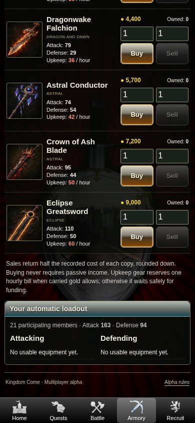
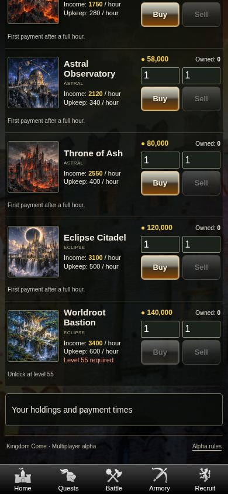

# Kingdom Come — Phase 3.5 browser reference gallery

These are actual Chromium captures of the implemented EJS interface, using qualified late-game characters in a disposable PostgreSQL database. No credentials or live-player data are included. The ordinary early-game browser test separately uses new accounts without administrative gold or XP grants.

The original five tabs, backgrounds, compact rows, resource strip and gradient controls remain. The paintings are previously generated fantasy art reused by Kingdom Come, not recovered original item art.

| Screen | Captures |
| --- | --- |
| Armory: Weapons | [Early equipment](armory-weapons-early.png) · [Dragon, astral and eclipse equipment](armory-weapons-late.png) |
| Armory: Armor | [Later armor and robes](armory-armor-late.png) |
| Armory: Spells | [Later mystical abilities](armory-spells-late.png) |
| Land | [Gold Flow and early properties](land-early.png) · [Later fantasy properties](land-late.png) |
| Profile | [Player statistics, income, illustrated ownership and account](profile.png) · [Five persistent skill attributes](skills.png) |
| Quests | [Successful level-50 finale](quest-finale.png) |
| Battle | [Persistent fantasy-equipped two-player report](battle-report.png) |

Captures shown here use a 390 × 844 phone viewport. The tests also cover 330px, 360px and 1366px widths, with no horizontal overflow or missing catalog illustrations. Profile/report use full-page captures; their fixed bottom navigation appears at the captured viewport's bottom within the longer image.

Regenerate the late-game captures with a disposable test database, local Chromium and `npm run test:browser:fantasy`. It exercises real quantity trades, property income rates, all three Profile tabs and five skill forms, equipment/discovery gates, the finale, PvP/private reports, maximum-wallet header layout and logout. Full artifacts are written to ignored `test-results/fantasy-browser/`.

These are browser viewport tests, not physical Android screenshots. See [the implementation and limitations](../../PHASE_3_5.md) and [current verification record](../../KINGDOM_COME_PHASE_3_5_VERIFICATION.json).
