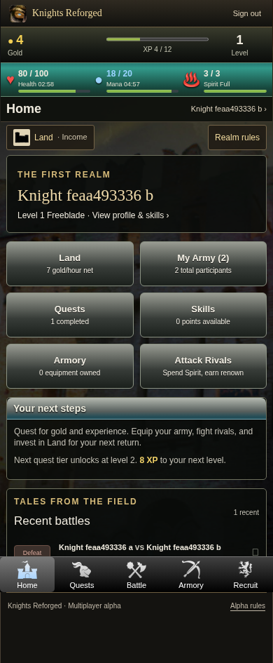
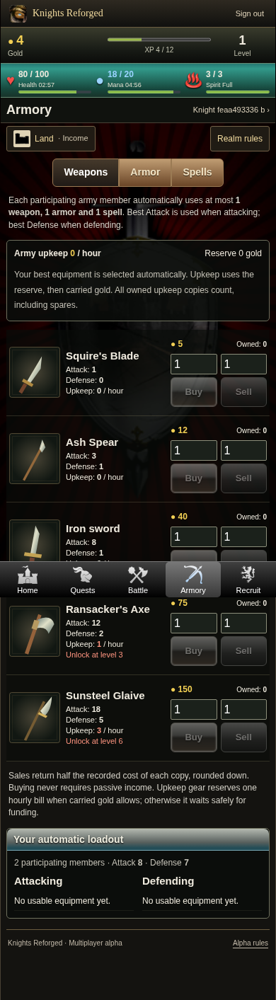
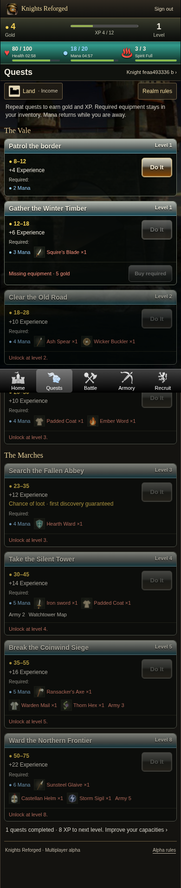
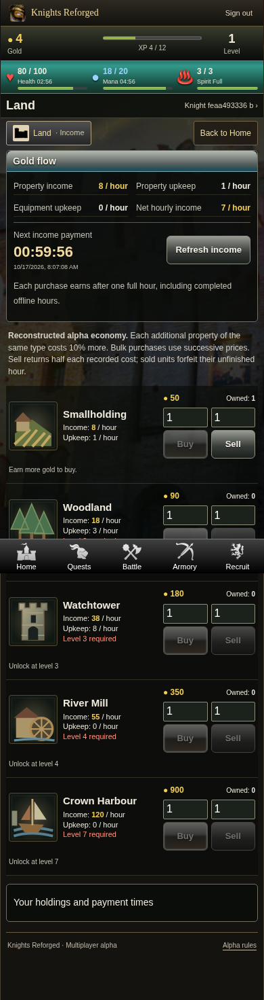
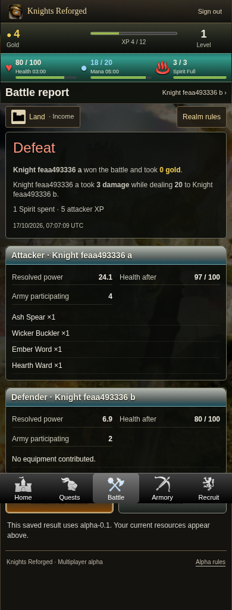

# Phase 3 alpha browser captures

These are captures of the new Knights Reforged alpha, **not historical Kingdoms Live reference images**. Source: gameplay commit `c110f06a35e3c752bfd4c2a83e923fedf04c1c30`, Chromium 154, 390×844 phone viewport. The sample players were created by the form-driven browser test. Full-page captures include the fixed navigation at the viewport boundary.

Recovered navigation and backgrounds are preserved; object illustrations are new placeholder SVG artwork. Physical Android rendering still needs verification.

| Home | Armory |
| --- | --- |
|  |  |

| Quests | Land |
| --- | --- |
|  |  |

