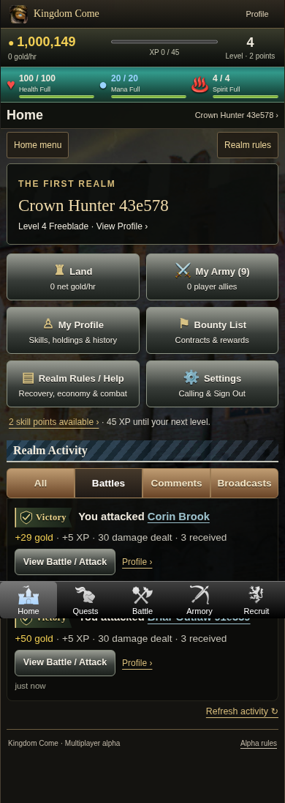
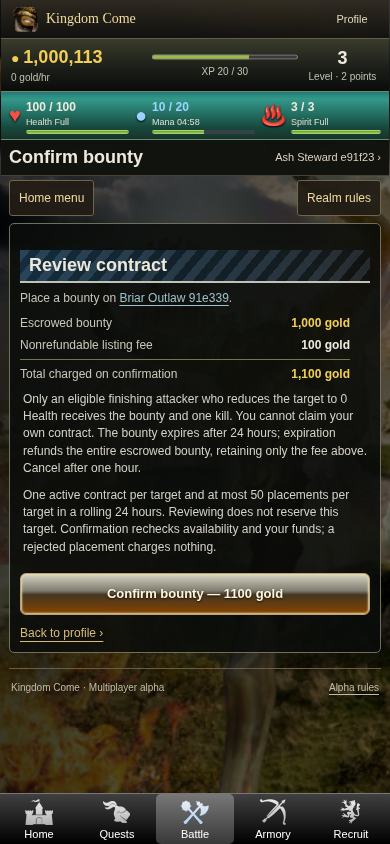

# Phase 4.1 — native-browser screenshots

These are actual Kingdom Come screenshots from the local Codespaces-style HTTPS fixture, not design mockups. Chromium used a 390px Android-style viewport. The fixture also checked 320, 360, 412, 430 and 1366px layouts. Test characters have explicit fixture grants for advanced content; the separate ordinary-form browser run verifies progression without those grants.

The existing recovered backgrounds/navigation and fantasy illustrations remain. This iteration adds a small handwritten heraldic SVG and CSS treatments; it does not claim newly generated paintings. Full-page captures can show the fixed bottom bar at the original viewport boundary.

| Screen | Screenshot |
| --- | --- |
| Home menu, Land entry and activity | [Home](390-home.png) |
| Battles feed and Victory shield | [Victories](390-battles.png) |
| Defeat shield, real losing encounter | [Defeat](390-defeat-activity.png) |
| Repeat attack stopped at 0 Health | [Finishing report](390-battle-report.png) |
| Available gold Do Again | [Quest result](390-quest-do-again.png) |
| Own character, income and holdings | [Player](390-profile.png) |
| Other player's persistent battle history | [Public Tales](390-public-tales.png) |
| Profile comment input, history and controls | [Comments](390-comments.png) |
| Public realm message board | [Broadcasts](390-broadcasts.png) |
| Persistent consenting invitation codes | [Recruit](390-recruit.png) |
| Army activity | [Army Dashboard](390-army-dashboard.png) |
| Exact principal, fee and total before payment | [Bounty confirmation](390-bounty-confirm.png) |
| Marked rivals and hunt actions | [Bounty List](390-bounty-list.png) |
| Existing property artwork and automatic income | [Land](390-land-starter.png) |

See [the implementation/runbook](../../PHASE_4_1.md) and [verification record](../../PHASE_4_1_VERIFICATION.json). Browser tests do not verify a physical Android device or installable APK.
