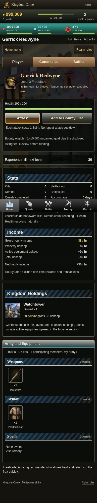
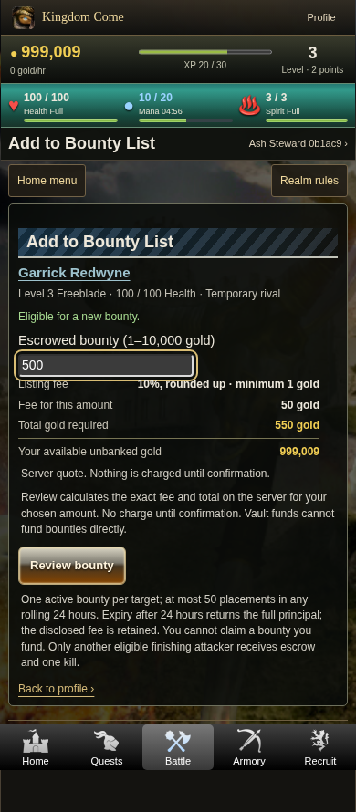
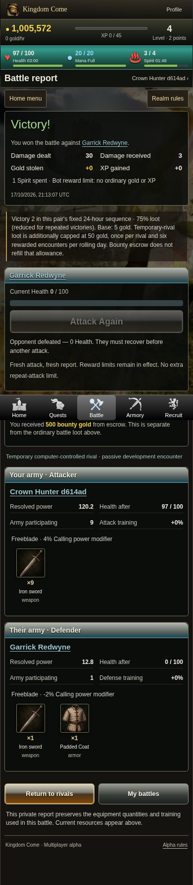
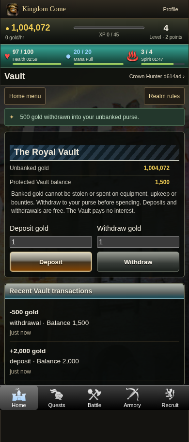

# Phase 4.2 mobile reference captures

These are real Chromium captures from a disposable PostgreSQL test realm behind a local Codespaces-style HTTPS forwarding fixture. Names/balances belong to test fixtures. Existing artwork is reused; no illustrations were generated for this milestone. Captures demonstrate browser layout, not physical Android or APK verification.

The automated layout sweep covers **320, 360, 390, 412, 430 and 1366px**. The committed images below use 390px width; the test checks 21 pages at each width, including high-level bot profiles and bounty placement. Full-page images retain fixed bottom navigation.

| Interface | Capture |
| --- | --- |
| Prominent bot Profile actions, Health and actual income | [Bot profile](390-bot-profile-actions.png) |
| Compact bot bounty placement with server-quoted fee/total | [Placement](390-bot-bounty-placement.png) |
| Exact human bounty confirmation | [Confirmation](390-bounty-confirm.png) |
| Funded listing and disclosed fee | [Sponsor history](390-bounty-sponsored.png) |
| Bounty List and hunt actions | [Bounty List](390-bounty-list.png) |
| Human finishing claim, ordinary loot separate | [Human bounty report](390-bounty-report.png) |
| Bot finishing claim after ordinary reward cap, target zero Health | [Bot bounty report](390-bot-bounty-claim.png) |
| Actual level-50 bot property portfolio, income and inventory | [Veteran bot profile](390-level50-rival-profile.png) |
| Vault balances and real native deposit/withdrawal history | [Vault](390-vault.png) |
| Rivals and preserved five-tab layout | [Battle](390-battle.png) |
| Home-only Land navigation and existing feeds | [Home](390-home.png) |
| Repeat attack, reduced loot and zero-Health stop | [Battle report](390-battle-report.png) |
| Persistent public battle history | [Public Tales](390-public-tales.png) |
| Preserved comments | [Comments](390-comments.png) |

