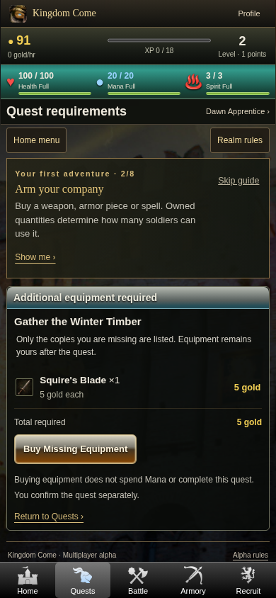
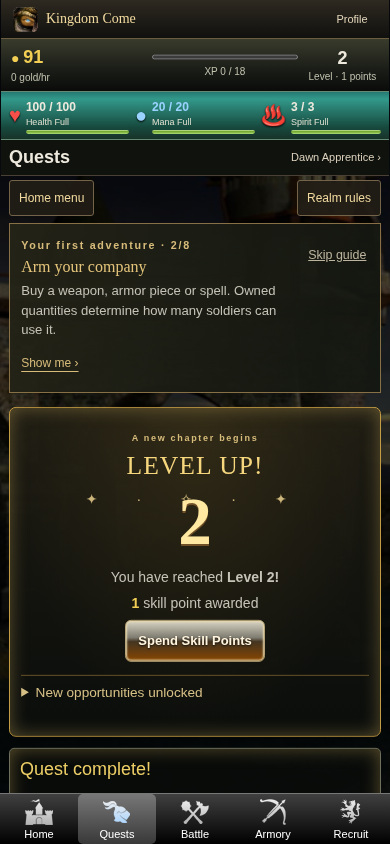
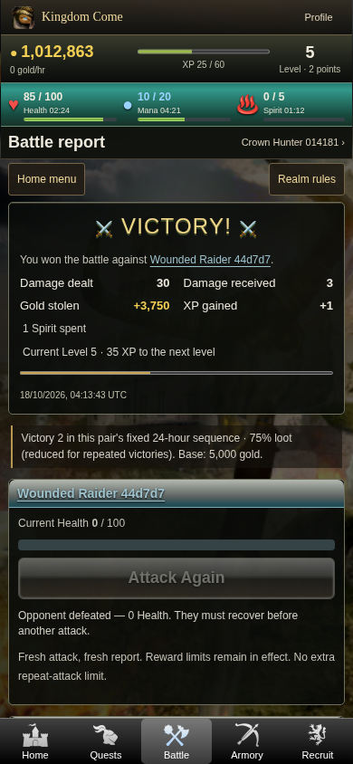
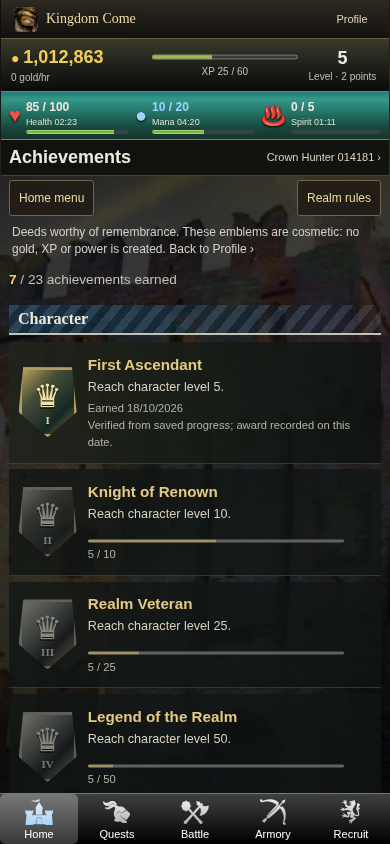
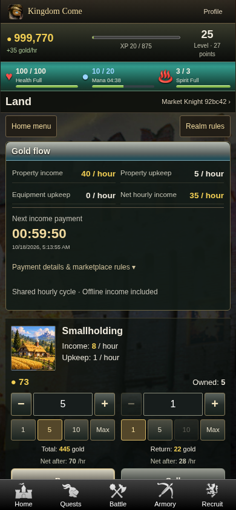
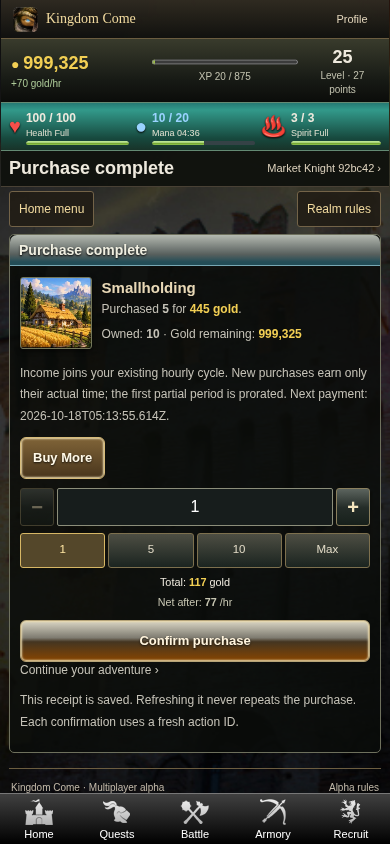

# Phase 4.4 — verified browser screenshots

Real Chromium captures of the running application through the local TLS/Codespaces forwarding fixture, at **390 × 844**. These are disposable synthetic test accounts and balances, not live Railway players. Existing artwork is unchanged. No reference screenshot is passed off as implemented UI.

| Screen | Capture |
| --- | --- |
| Home announcement and optional guide | [Home](390-home-tutorial.png) |
| All Regions quest filter | [Quests](390-quests.png) |
| Exact missing-equipment purchase | [Quest requirements](390-quest-equipment.png) |
| Explicit quest completion/rewards | [Quest rewards](390-quest-reward.png) |
| Actual quest-triggered level-up | [Level up](390-level-up.png) |
| Victory, XP, damage and Attack Again eligibility | [Battle victory](390-battle-victory.png) |
| Persistent earned/progress medal collection | [Achievements](390-achievements.png) |
| Land rows and 1/5/10/Max controls | [Land marketplace](390-land.png) |
| Server-validated property confirmation | [Land confirmation](390-land-confirmation.png) |
| Private receipt and immediate Buy More | [Buy More](390-buy-more.png) |

Automated layout/accessible-name checks also passed at 320, 360, 375, 393, 412, 430 and 1366px, including Android/iPhone-like widths. They do not verify physical Android/iPhone hardware, Safari, APK/WebView behavior or the live Railway edge. Reduced-motion and receipt-animation replay checks passed. See [verification](../../../PHASE_4_4_VERIFICATION.json) and [release procedure](../../../PHASE_4_4_RELEASE.md).

