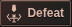

# Phase 4.8 — final shared visual polish

Prepared for owner visual review on `feature/kingdom-come-phase-4-8-ui-remaster`, from `d71e8529804b408b04750cce0fe3b1c2130ac6b7`. This is a focused finish pass on the approved composition. It is not a production release.

## Screenshots

These are native, unretouched browser captures of actual server-rendered pages. All accounts, purchases and combat records belong to an isolated local PostgreSQL test fixture. No production account or database was used. Mobile screenshots are 844px tall; desktop screenshots are 1024×1536. [Capture checksums](final-polish/screenshots.json) and [browser measurements](final-polish/browser.json) accompany the images.

| Screen | 390px | 320px | 430px | 1024px |
|---|---|---|---|---|
| Home | [View](final-polish/screenshots/390-home.png) | [View](final-polish/screenshots/320-home.png) | [View](final-polish/screenshots/430-home.png) | [View](final-polish/screenshots/1024-home.png) |
| Armory | [View](final-polish/screenshots/390-armory.png) | [View](final-polish/screenshots/320-armory.png) | [View](final-polish/screenshots/430-armory.png) | [View](final-polish/screenshots/1024-armory.png) |
| Land | [View](final-polish/screenshots/390-land.png) | [View](final-polish/screenshots/320-land.png) | [View](final-polish/screenshots/430-land.png) | [View](final-polish/screenshots/1024-land.png) |
| Battle | [View](final-polish/screenshots/390-battle.png) | [View](final-polish/screenshots/320-battle.png) | [View](final-polish/screenshots/430-battle.png) | [View](final-polish/screenshots/1024-battle.png) |
| My Profile | [View](final-polish/screenshots/390-profile.png) | [View](final-polish/screenshots/320-profile.png) | [View](final-polish/screenshots/430-profile.png) | [View](final-polish/screenshots/1024-profile.png) |

Home activity: [390px screen](final-polish/screenshots/390-home-recent-activity.png), [both actual battle entries](final-polish/screenshots/390-outcomes-context.png), [Victory heading](final-polish/screenshots/390-victory-heading.png), [Defeat heading](final-polish/screenshots/390-defeat-heading.png).

| Victory close-up | Defeat close-up |
|---|---|
|  |  |

The exact [definitive Land mockup](ChatGPT%20Image%20Oct%2020%2C%202026%2C%2012_34_13%20AM.png) remains the visual authority. It is unchanged. Compare it at native size with the [1024px Land capture](final-polish/screenshots/1024-land.png).

## Exact changes

1. **Button depth:** bronze actions use layered metallic gradients, a faint diagonal reflection, a brighter upper edge, side highlights, a lower bevel and restrained shadows. Secondary actions retain a darker steel finish. Pressed, hover and keyboard-focus states are consistent. Existing button dimensions and hit targets are unchanged.
2. **Typography:** prominent headings, item names, prices and primary actions retain serif type. Supporting activity text, timestamps, hints, profile statistics and mobile marketplace metadata use a quieter system sans-serif. Weight distinguishes names and values from supporting prose. At 320px the paired Armory Attack/Defense line retains its compact serif so both values fit without smaller text or taller rows. No font download or library was added.
3. **Scenery integration:** refined the existing backdrop overlay, with a softer lateral shade and gradual lower darkening. Panel faces use subtle translucency and reflection; text remains on dark surfaces. Scenery, property artwork, framing, resource/header composition and bottom-navigation artwork are unchanged.
4. **Panel finish:** shared panels and marketplace rows use coordinated upper/lower edge tones, inset highlights and small outer shadows. Existing corner radii, padding, grid tracks and section gaps remain intact.
5. **Spacing and proportions:** preserved the approved mobile/desktop geometry. Automated before/after comparisons cover header/navigation, Home menu buttons, first six marketplace rows, artwork frames and Buy/Sell rectangles at eight widths. Mobile marketplace rows remain 98px; **five complete Land rows fit at 390×844 with Gold Flow collapsed**. Buy/Sell targets remain at least 44×44px.
6. **Icons:** refined four original Home symbols: stone gatehouse, greathelm, ironbound coffer and forged gear. Added original crown/laurel and broken-sword outcome emblems. The existing original bottom-navigation artwork is retained. All icons remain decorative beside real accessible text labels. The original vector geometry is CC0; see [asset provenance and hashes](../../public/art/remaster-ui/provenance.json).
7. **Battle outcomes:** replaced the inherited green shield/ribbon treatment with compact, squared metal captions. Victory uses bronze/gold with a crown and laurel; Defeat uses muted red/dark metal with a broken sword. The words remain visible, so color alone does not convey the result. These are read-only statuses, not buttons. The shared partial also keeps history/Tales outcomes consistent. Winner selection, gold, XP, damage, timestamps and profile/report links are unchanged.
8. **Home heading:** visible `Realm Activity` becomes **Recent Activity**. The All, Battles, Comments and Broadcasts tabs, `activity-title` identifier, URLs, event types and backend terminology are unchanged.

## Verification

Fresh results for this pass are recorded in [verification-final-polish.json](verification-final-polish.json).

- TypeScript checking and production compilation pass.
- Static validation: **94 checks, zero failures**, covering **73 production EJS fixtures**, anonymous/authenticated rendering, asset provenance, escaped content, navigation and form contracts. Added assertions cover the new outcome emblems and visible Home heading.
- Focused regression: **61 tests, zero failures/skips**. Includes transaction recovery, quantity/receipt behavior, profile income and inventory, rendering, combat/social records, moderation/tutorial preservation, HTTPS/Origin/CSRF protections and populated-fixture preservation.
- [Dedicated visual browser report](final-polish/browser.json): **45 visits**, eight widths (320, 360, 390, 412, 430, 768, 1024, 1366), 26 review captures, no horizontal overflow or JavaScript errors, exact before/after marketplace/header/menu geometry. Both displayed outcomes come from real persisted combat in the test fixture.
- [Shared-screen browser report](final-polish/shared-browser.json): **176 visits**, including quests, profile, recruitment, Vault, settings, tutorial, five-tab navigation, locked regions, large balances and preservation of the synthetic 450-bot identities.
- [Marketplace browser report](final-polish/marketplace.json): **56 responsive visits** plus one-item duplicate suppression, receipt refresh, lost committed-response recovery, bulk/Buy More, authoritative sale refunds, three-hour simulated idle, expired-session retention, keyboard-operated Gold Flow and 44px action targets.
- Accessibility checks cover visible text labels, non-interactive outcome semantics, keyboard focus/disclosures, reduced-motion behavior and marketplace target sizes. This is not a complete WCAG conformance audit.

The test database is local-only and explicitly named `phase48_test`. Fixture schemas are isolated and removed by the test helpers. The visual review checks that gold, XP, Vault, inventory, Land, units and battle statistics do not change during read-only page review.

[Geometry evidence](final-polish/geometry-preservation.json) includes the unchanged rectangle sets and baseline commit. From the application directory, the dedicated check is reproducible with `TEST_DATABASE_URL` pointing to a disposable local `_test` database:

```sh
npm exec -- tsx scripts/browser-phase48-polish.ts
```

The script uses the checked-in baseline when no local baseline exists. It blocks external browser requests and never reads a production database URL.

## Preservation and remaining differences

- No gameplay handler, financial calculation, database migration, catalog/ruleset, client transaction script, sound asset, deployment script or GitHub workflow changed. No account reset, bot regeneration, moderation action, merge or deployment was performed.
- The mockup is an illustration; the implementation uses the real catalog, balances, recovery values and clock. It retains actual Bulk, resale amounts, income disclosures and other functional controls absent from the illustrative target.
- The approved original replacement property scenes and navigation illustrations remain; they are not the exact pixels in the mockup. Later properties retain their existing original catalog illustrations.
- Supporting text intentionally uses a readable system sans-serif where the mockup uses more serif text. Metallic material is rendered with lightweight CSS gradients and shadows, rather than a painted button texture. The new small outcome emblems and four Home icons are original SVG geometry, not borrowed game artwork.
- Mobile reflow remains an adaptation of the approved composition, not a scaled-down 1024px image. The exact measured layout is preserved from the prior approved implementation; no visual-equivalence claim is made.
- Browser checks use Chromium touch emulation. Physical Android/iPhone, Safari rendering, screen-reader testing and subjective owner review remain necessary. No new audio was adopted; the separate sound audition remains pending.

Work pauses here for the owner's visual review. Nothing has been merged into `release/production` or deployed to Railway.
