# Kingdom Come — compact UI polish review

**Review mockups only.** These are Chromium renders of the real local game with synthetic accounts, existing artwork, a review-only stylesheet and an isolated name/art permutation. No runtime stylesheet, template, ruleset, database migration or release file is changed. Nothing has been adopted, merged or deployed.

Base: `release/production` at `dd5841349056e2f6d8c0ae79018f91909b7dbffc` (includes the merged classic Profile layout).

## Main screen comparisons

390px viewport, shown at native screenshot resolution. Existing icon sizes and five-tab navigation are preserved. The supplied reference informed framing and warm-metal finishes; its artwork, invented statistics and large header were not copied.

| Screen | Current | Review proposal |
| --- | --- | --- |
| Weapons | 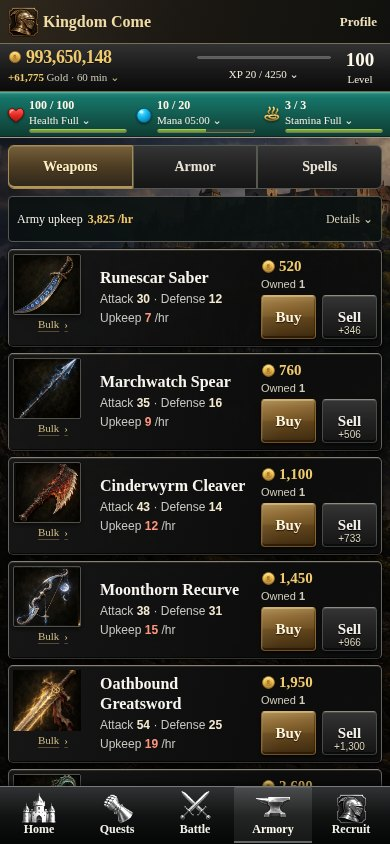 | 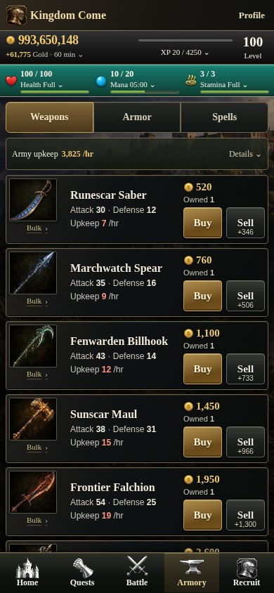 |
| Armor | 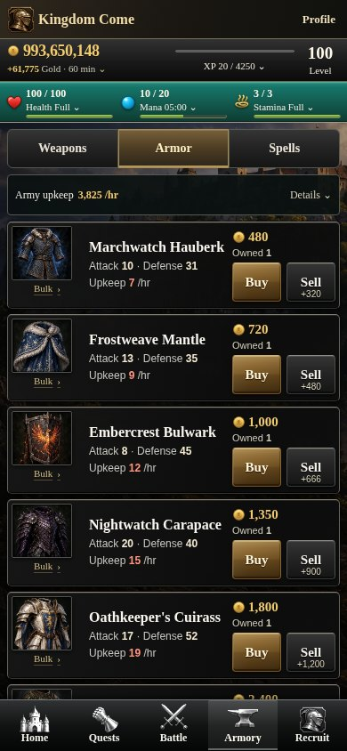 | 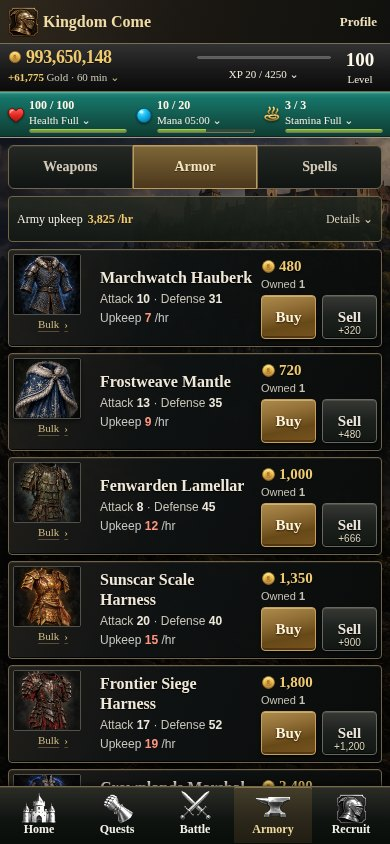 |
| Spells | 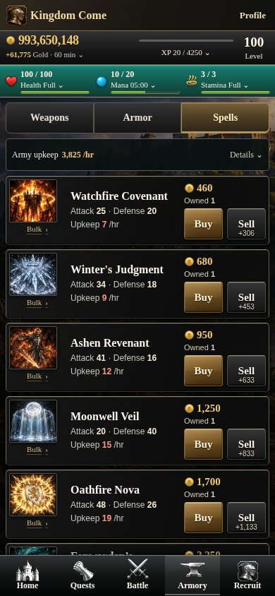 | 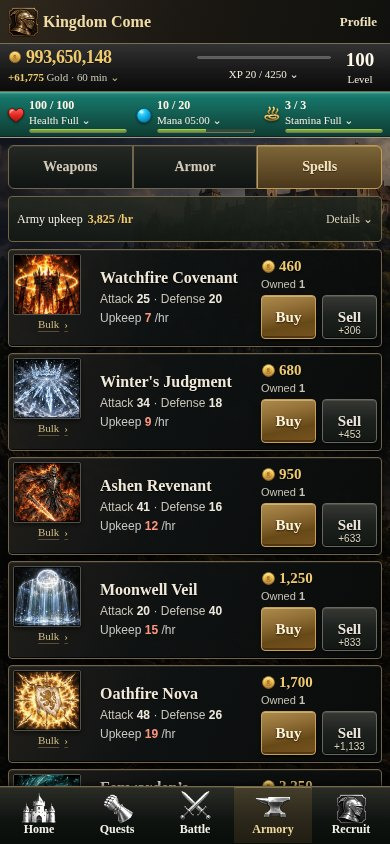 |
| Battle / Rivals | 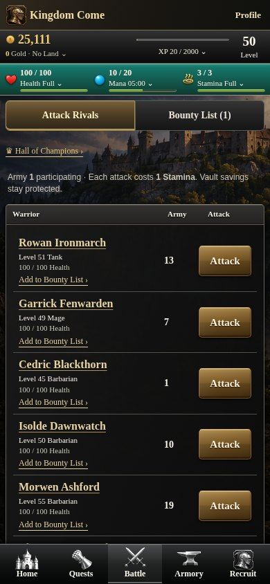 | 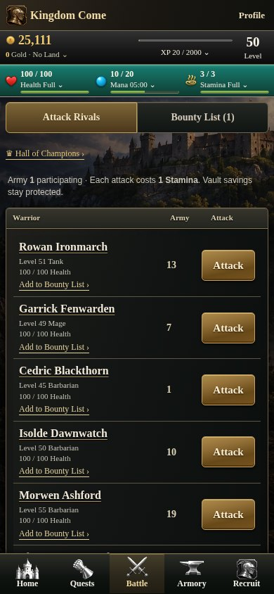 |
| Land | 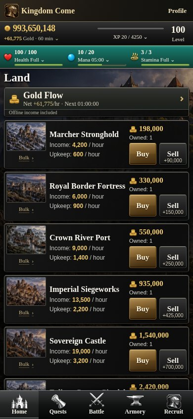 | 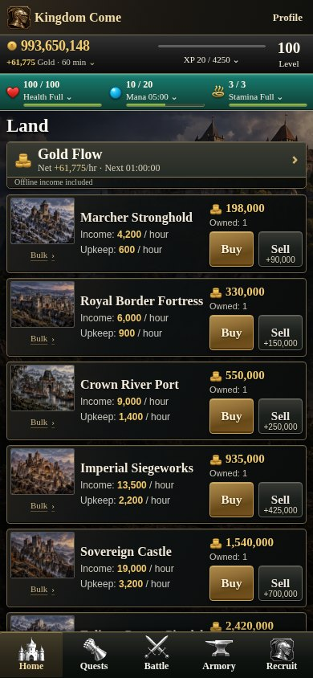 |

Desktop: [Armory, 1024px](screenshots/1024-preview-weapons.jpg) · [Land, 1024px](screenshots/1024-preview-land.jpg).

## What changes visually

- Charcoal row surfaces with quiet texture, warmer bronze edges and restrained inset relief.
- Consistent bronze/gold Buy and Attack buttons; dark steel Sell buttons.
- Ivory equipment names, clear gold prices, quieter secondary text and consistent selected tabs.
- The existing castle backdrop remains subordinate to readable rows. Item illustrations receive no filters, recoloring, new backgrounds or framing changes.

The row layout, columns, typography sizes, icon dimensions, purchase links and controls remain intact. The teal resource header, resource values, current labels/icons and all five navigation destinations remain intact. No new panel, permanent tab, notification or Home redesign is proposed.

**Safe first integration:** adopt the row surfaces, button finishes and selected-tab treatment together, after visual review. Keep the compact native layout and existing form/CSRF/idempotency paths. The stylesheet lives here in documentation and is injected only by the browser fixture; the game does not load it.

## Requested name/image ordering — inactive candidate

The preview moves each requested name and its existing image together through the fixed numerical slots. It preserves the order of intervening identities, which shifts **15 weapon and 16 armor presentation slots**. No identity is duplicated or discarded. The complete permutation, original names, IDs and unchanged numerical values are recorded in [presentation-candidate.json](presentation-candidate.json).

| Display name moved | Fixed destination ID | Existing slot level | Attack / Defense | Price | Upkeep/hr |
| --- | --- | ---: | ---: | ---: | ---: |
| Cinderwyrm Cleaver | `royal-warblade` | 60 | 128 / 44 | 10,500 | 54 |
| Moonthorn Recurve | `march-wardens-poleaxe` | 70 | 72 / 96 | 14,500 | 62 |
| Oathbound Greatsword | `sovereigns-zweihander` | 70 | 140 / 52 | 15,500 | 69 |
| Embercrest Bulwark | `citadel-harness` | 60 | 29 / 134 | 11,500 | 56 |
| Nightwatch Carapace | `ducal-warplate` | 70 | 63 / 110 | 15,000 | 70 |
| Oathkeeper's Cuirass | `fortress-bastion-plate` | 70 | 35 / 153 | 17,000 | 73 |

In the proposed display sequence:

- Mountain Warden’s Zweihander → Cinderwyrm Cleaver → Moonthorn Recurve → Oathbound Greatsword → Stormglass Pike.
- Moonfen Sentinel Harness → Embercrest Bulwark → Nightwatch Carapace → Oathkeeper's Cuirass → Astral Archon Robes.

| Actual-size row strips | Current | Proposed |
| --- | --- | --- |
| Weapons | 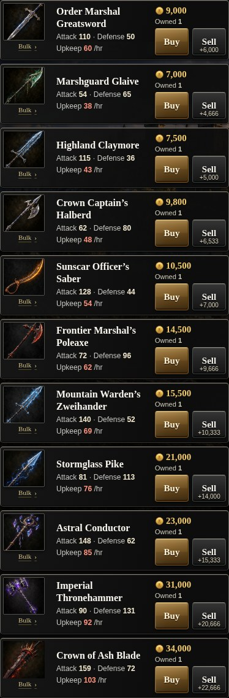 | 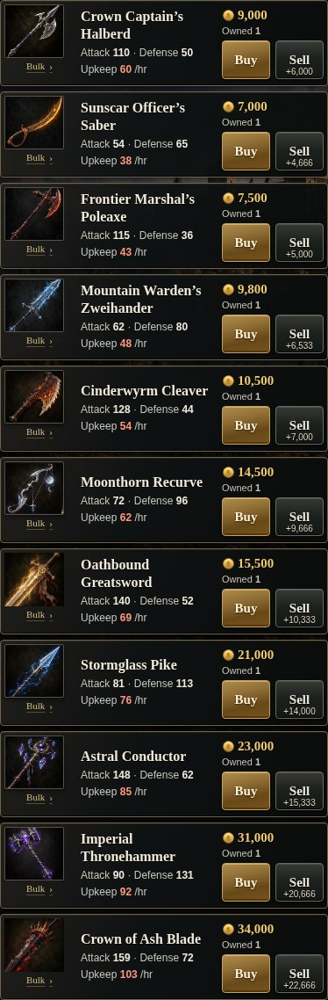 |
| Armor | 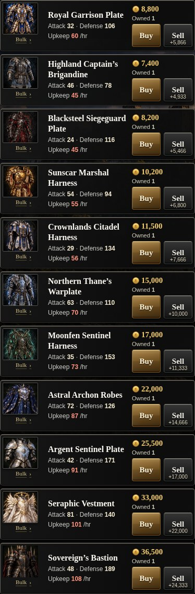 | 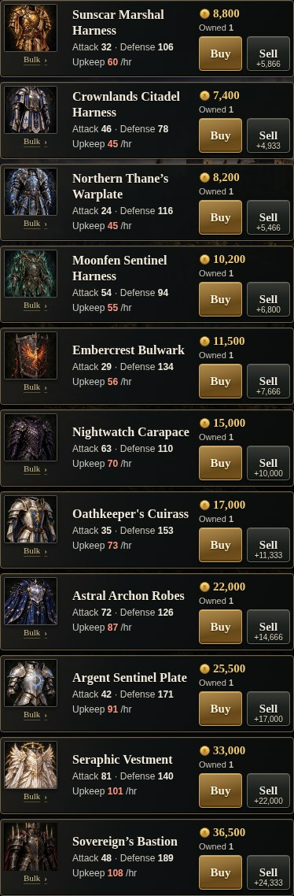 |

These are image/name moves, **not stat moves**. Levels, prices, attack/defense, upkeep, quantities, categories, acquisition restrictions and stable item IDs remain attached to their original slots. This is not an active registry or adoption mechanism. Actual integration would need a new reviewed immutable presentation/artwork version and historical-receipt compatibility; it must not rewrite existing deployed definitions.

## Bounty-level requirement

No gameplay correction was needed: the current exact-contract bounty-hunt path already bypasses ordinary rival-level matching. The local preview shows a **level-100 hunter with an enabled Hunt action for a level-5 target**, and the same disposable fixture successfully claims that contract with its existing 1,000-gold escrow. [Bounty-list preview](screenshots/390-preview-bounty-list.jpg).

The existing focused regression suite also verifies high-to-low and low-to-high hunts, invalid contracts, normal PvP range rejection, simultaneous claims, replay safety and allied hunters. Bounty **placement** rules remain unchanged. No live production behavior was inspected or claimed verified.

## Verification and limitations

- 46 browser views: before/proposal at 320, 390, 430 and 1024px, plus progression and cross-level bounty views at 390px.
- No horizontal overflow, missing requested assets or browser errors; all five navigation targets remain at least 44px. Exact per-row displayed names, source IDs and image paths are asserted.
- Icons match baseline dimensions at each width. Styling does not increase row heights for the same displayed names. Longer replacement names can naturally wrap; they are not clipped or shrunk.
- At 390px, Armory rows remain 98px high. At 320px the existing responsive layout allows longer rows rather than truncating names; desktop rows remain 126px high.
- A real purchase through the existing browser form increments only the intended stable-ID quantity; the numerical catalog and active presentation/artwork digests remain unchanged.
- Focused server regressions: **5 passed, 0 failed, 0 skipped** (`tests/phase6-combat.test.ts`). TypeScript and static checks pass; static checks include **77 existing production EJS fixtures** (99 checks). [Focused-check results](focused-checks.json).
- See [verification.json](verification.json) for measured dimensions, all rendered identities, policy fingerprints and hashes of the 52 existing artwork files requested by the local browser. Hashes reference existing assets; no illustrations were generated or edited.

For review, the fixture shows the level-12–50 marketplace window and the six later Land properties; separate row strips show the progression window. These are camera windows, **not new game filters**. Both Land comparisons use the existing collapsed Gold Flow disclosure. Row-only strips omit fixed page chrome to prevent tall-element screenshot artifacts; full-screen comparisons retain navigation. Screenshots use synthetic accounts and real computed catalog values, not production players.

The preview uses reduced-motion mode. External browser requests are blocked; CSP remains enabled. Only a local intercepted same-origin CSS response supplies the review skin. There is no public preview/administration endpoint, player-selectable skin switch, migration or production connection.

## Reproduce locally

Use the project's existing dependencies and a designated disposable PostgreSQL test database. The fixture creates and drops an isolated schema; never point it at a live realm.

```sh
TEST_DATABASE_URL=postgres://USER@127.0.0.1:PORT/kingdom_test \
BROWSER_EXECUTABLE=/usr/bin/chromium \
node --import tsx scripts/browser-ui-polish-mockups.ts
```

The command regenerates screenshots and evidence here, exercises the existing purchase/bounty commands against disposable accounts and closes the local server. No full CI or protected workflow is required for this mockup-only review.
